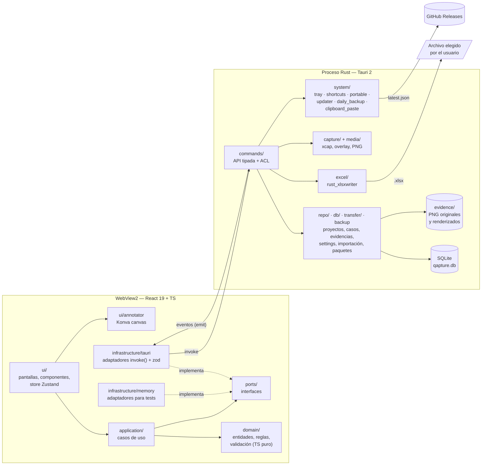

# Arquitectura de Qapture

Qapture es una app de escritorio Tauri 2: la interfaz es React 19 + TypeScript dentro de WebView2, y el núcleo es Rust. El diseño completo y sus decisiones están en el [spec](superpowers/specs/2026-10-15-qapture-design.md); aquí está el resumen de cómo está armado el código. Las decisiones grandes tienen su [ADR](adr/).

## Capas

Diferencias con el diagrama original del spec (§4.1): la capa de servicios de Rust quedó repartida en `repo/`, `db/`, `transfer/` y `backup.rs`; `capture/` lleva también a `media/`; y `system/` incluye `portable`, `daily_backup` y `clipboard_paste`.

### TypeScript (`src/`)

| Capa | Hace | No hace |
|---|---|---|
| `domain/` | Entidades, reglas y validación (espejo de Rust para respuesta inmediata), resumen, atajos, versiones de actualización | I/O, React, Tauri |
| `application/` | Casos de uso orquestados con puertos | Conocer SQLite o el canvas |
| `ports/` | Interfaces (`repositories`, `capture`, `export`, `data`, `settings`, `updater`, `errors`) | — |
| `infrastructure/tauri/` | Implementa los puertos con `invoke()` y valida cada respuesta con `zod` | Lógica de negocio |
| `infrastructure/memory/` | Implementa los mismos puertos en memoria, para tests | — |
| `ui/` | Pantallas, store Zustand, editor de anotaciones (Konva) | Validación de negocio (la delega al dominio) |

Reglas: `ui → application → domain`; `infrastructure` implementa `ports`; `domain` no importa nada externo.

### Rust (`src-tauri/src/`)

| Módulo | Responsabilidad |
|---|---|
| `commands/` | API pública mínima hacia el WebView; `names.rs` es la lista única de comandos |
| `repo/`, `db/` | Repositorios SQLite, migraciones (`PRAGMA user_version`), siembra de plantillas, modo recuperación |
| `domain/` | Reglas de campos, estados y texto, espejo del dominio TS |
| `media/` | Archivos de evidencia y rasterizado de PNG |
| `capture/` | Captura de pantalla (`xcap`), ventana overlay de selección y recorte |
| `excel/` | Generación del `.xlsx`: carátula, matriz, evidencias y resumen |
| `transfer/` | Importar Bitácora v1 y exportar/importar paquetes `.qapture` |
| `backup.rs` | Respaldos diarios, manuales y de seguridad |
| `system/` | Bandeja, atajos globales, modo portable, updater, respaldo diario, pegado del portapapeles |
| `integrations/github/` | Conexión con GitHub ([ADR 0005](adr/0005-integracion-github.md)): `config`, `client` (reqwest + rustls, errores a `AppError::GitHub`), `token_store` (llavero), `auth` (Device Flow), `repos`, `project_config`. Comandos `gh_*` en `commands/github.rs` |
| `settings.rs`, `state.rs`, `error.rs`, `dto.rs` | Ajustes, estado compartido, `AppError` tipado y DTO serializables |

Los plugins de Tauri (single-instance, dialog, opener, global-shortcut, clipboard, notification, updater, autostart) se usan **solo desde Rust**; el WebView no recibe permisos de plugins que no necesite.

## Flujo de un comando: zod ↔ DTO ↔ ACL

1. La UI llama a un caso de uso, que usa un puerto.
2. El adaptador de `infrastructure/tauri` llama `call(comando, args, esquemaZod)` (`client.ts`), que ejecuta `invoke()`.
3. **ACL:** Tauri solo deja pasar el comando si su permiso `allow-<comando>` está en `capabilities/main.json` (o `overlay.json` para la ventana de captura). Cada comando nuevo va en tres sitios: `commands/names.rs`, `generate_handler!` en `lib.rs` y la capability; hay tests que lo verifican.
4. El comando de Rust deserializa el argumento y **revalida todo** (el dominio TS no es la única barrera), trabaja con repositorios y devuelve un **DTO** (`dto.rs`) serializado. Un error sale como `AppError { code, message, detail }`.
5. De vuelta en TS, la respuesta se valida con un esquema `zod` estricto. Si no coincide, se lanza un `AppError` de código `contract`. Los errores de Rust se convierten en `AppError` con mensaje en español.

Los tipos compartidos se protegen con **tests de contrato** ([ADR 0004](adr/0004-tests-de-contrato.md)): Rust genera `src/infrastructure/tauri/__fixtures__/contracts.json` y los esquemas `zod` lo validan.

## Eventos

Rust avisa al WebView con eventos (no hay sondeo):

| Evento | Quién lo emite | Para qué |
|---|---|---|
| `evidence:captured` | Captura (botón, `Ctrl+Alt+S`) y pegado (`Ctrl+Alt+V`) | Hay una imagen lista en `_staging`; la UI abre el editor |
| `shortcut:new-case` | Atajo «Nuevo caso» | La UI abre el formulario de caso en el proyecto activo |
| `update:available` | Updater (al iniciar, cada 6 h o revisión manual) | Hay una versión nueva; la UI abre el diálogo y muestra el indicador |
| `update:show` | Bandeja («Buscar actualizaciones» / «Instalar actualización») | Pedido explícito: la UI abre el diálogo aunque la versión se haya pospuesto |
| `update:progress` | Updater durante la descarga | Avance «Descargando actualización… n %» |
| `gh:connected` | Device Flow de GitHub, al autorizar | La cuenta quedó conectada; lleva la cuenta (login, nombre, avatar) y nunca el token |
| `gh:connect-failed` | Device Flow de GitHub | El código venció, se canceló o falló; lleva `{ message }` en español |

## Integración con GitHub

Todas las llamadas a `api.github.com` salen de Rust; el WebView solo invoca comandos. El token vive en el llavero del sistema (servicio `com.teams4soft.qapture`, cuenta `github`) y no aparece en DTO, eventos, logs, base de datos, respaldos ni paquetes.

| Comando | Qué hace |
|---|---|
| `gh_connect_start` / `gh_connect_cancel` | Inicia o cancela el Device Flow; un segundo inicio cancela el sondeo anterior |
| `gh_account` / `gh_disconnect` | Lee la cuenta conectada (o `null`) / borra token y cuenta |
| `gh_list_repos` | Repos donde la App está instalada, con permisos del usuario; un 401 activa «Reconectar» |
| `gh_project_github_get` / `gh_project_github_set` | Repos vinculados, ruteo y repo de evidencias del proyecto |

Los datos están en la migración `0005_integrations.sql` (`gh_account`, `project_repo_link`, `project_gh_settings`, `case_issue_link`). El comando `open_link` acepta además los destinos `githubDevice`, `githubInstall`, `githubRevoke` y `githubAdminGuide` (la guía para el admin, `docs/usuario/github-admin.md` en GitHub), siempre con URL fijas en Rust.

## Dónde viven los datos

| | Instalada | Portable |
|---|---|---|
| Carpeta | `%APPDATA%\com.teams4soft.qapture` | `data\` junto a `Qapture.exe` (existe `portable.flag`) |
| Base | `qapture.db` | `data\qapture.db` |
| Capturas | `evidence\` (y `_staging` mientras se editan) | `data\evidence\` |
| Respaldos | `backups\` | `data\backups\` |
| Capturas huérfanas tras restaurar | `evidence-sin-uso\` | `data\evidence-sin-uso\` |

`system/portable.rs` decide la carpeta al arrancar. Si la carpeta portable no es escribible, la app muestra un mensaje y se cierra: nunca cae en silencio a `%APPDATA%`, porque partiría los datos en dos lugares. Instalada y portable comparten la instancia única, así que solo una puede estar abierta a la vez.

## Publicación

`ci.yml` valida cada PR y `release.yml` construye cada tag `vX.Y.Z` y deja un **borrador** de release con los instaladores, el ZIP portable y `latest.json`. El updater consulta `releases/latest/download/latest.json`, que ignora borradores: una versión llega a las apps cuando alguien **publica** el borrador. Los pasos están en [CONTRIBUTING.md](../CONTRIBUTING.md#publicar-una-versión) y la verificación manual en [release-checklist.md](release-checklist.md).
