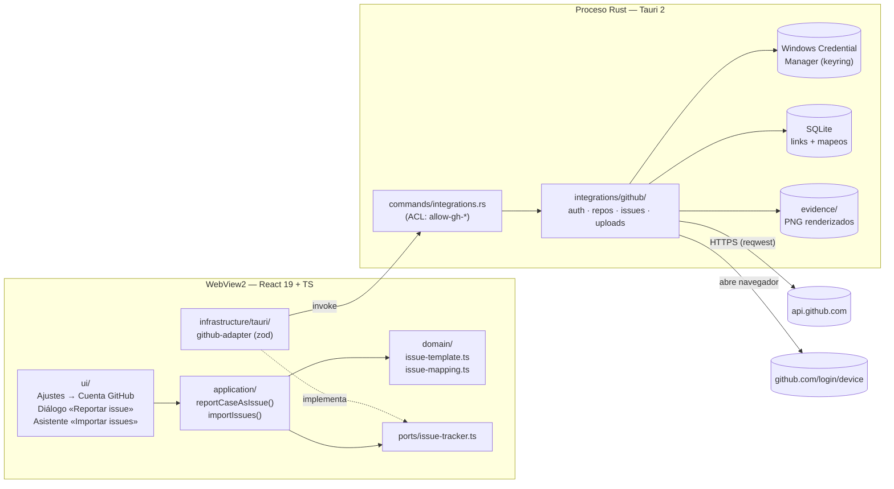
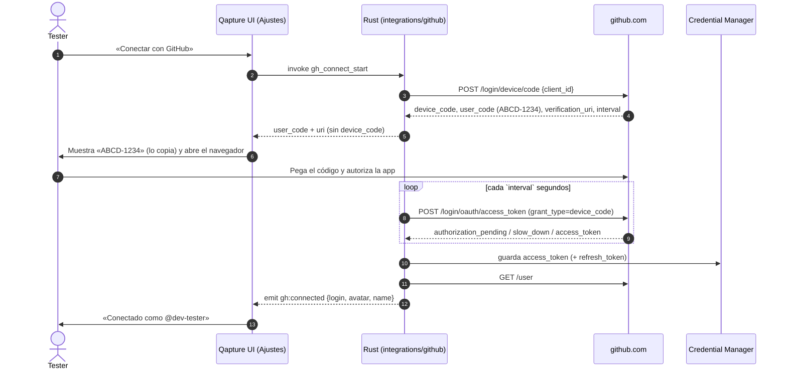
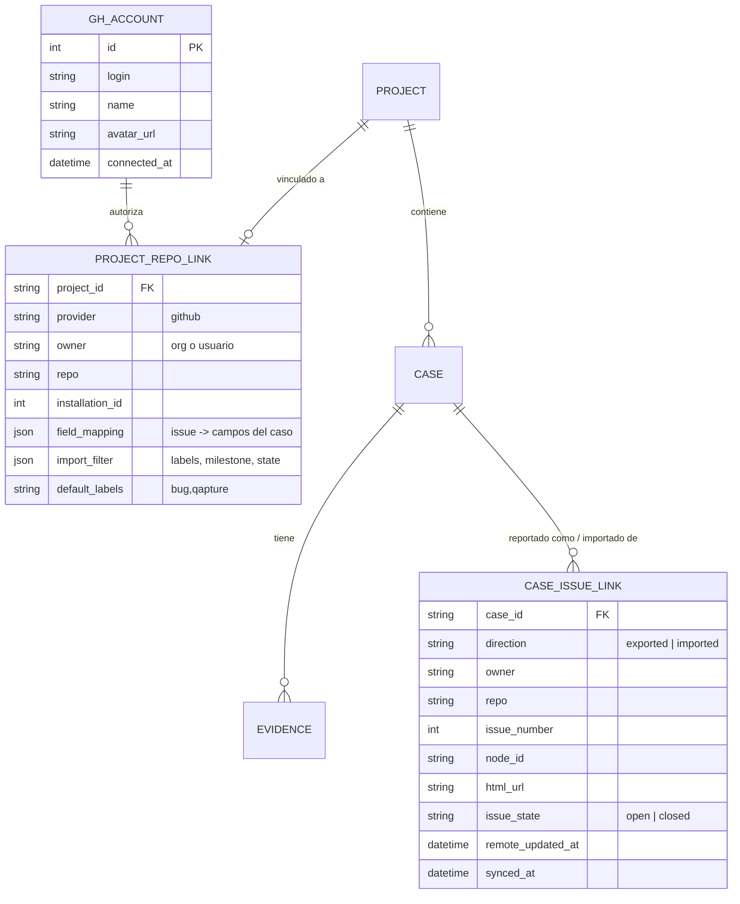
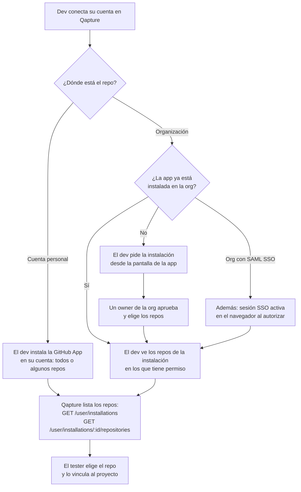
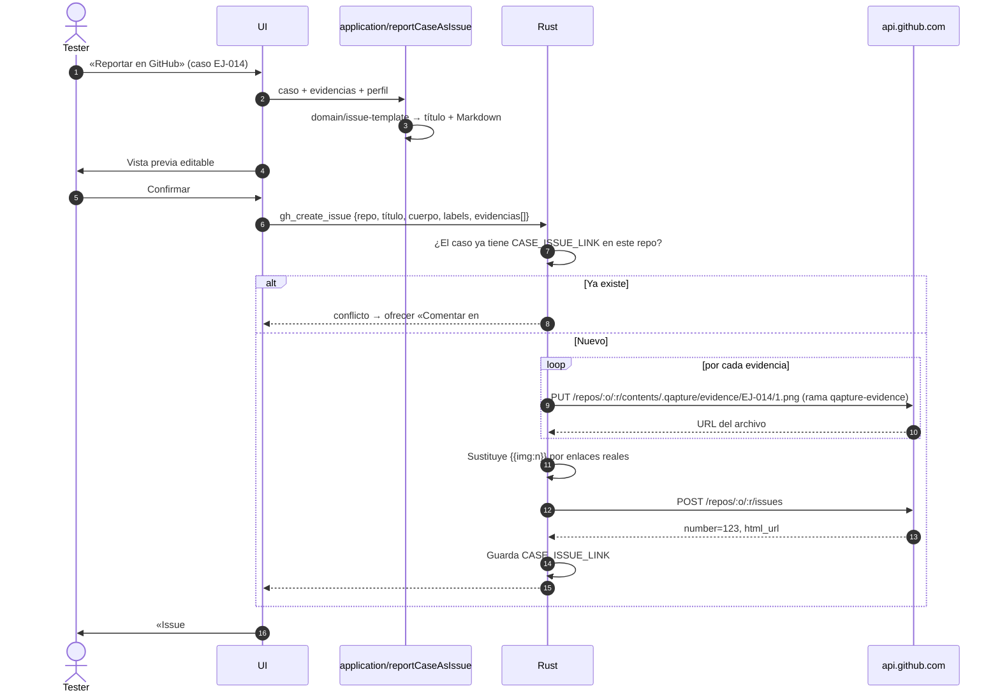
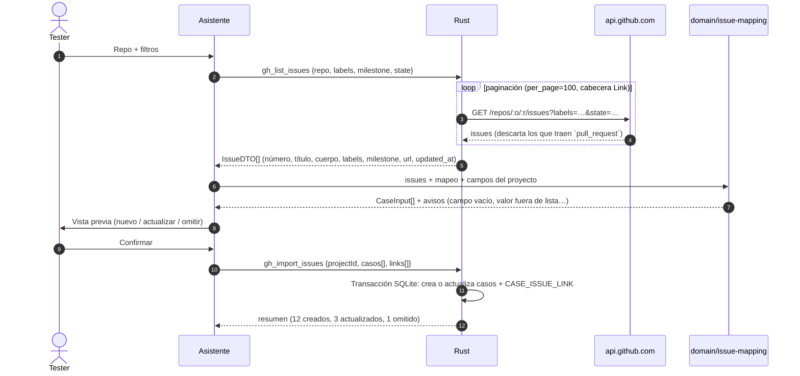
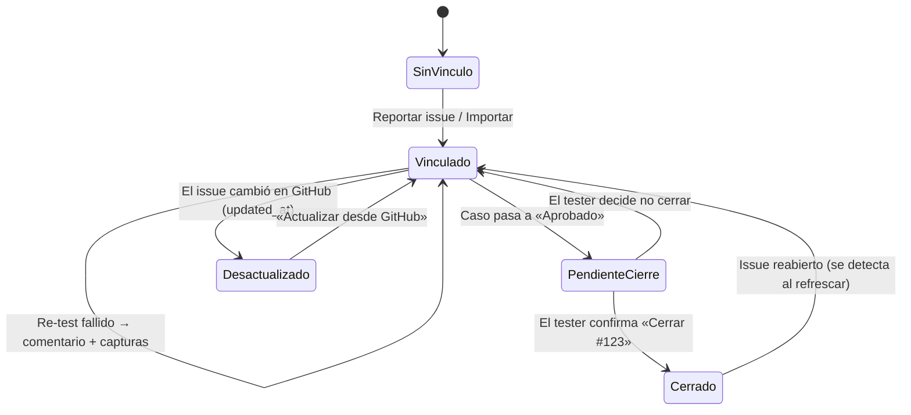
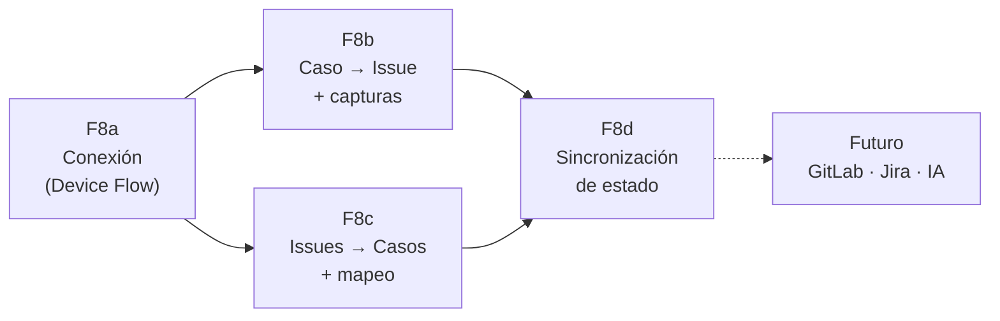

# Propuesta: integración con GitHub (Issues ↔ Casos de prueba)

> Estado: **propuesta / análisis de viabilidad**. No es un spec aprobado.
> Fecha: 2026-10-19 · Versión objetivo tentativa: **v1.1 – v1.3** (fase F8)

## 1. Resumen

Se quiere que Qapture, sin dejar de ser una app de escritorio local, pueda:

1. **Conectar la cuenta de GitHub** del tester desde **Ajustes → Perfil**, con autorización explícita.
2. **Elegir repositorios** a los que esa persona tiene acceso: personales **y** de organizaciones donde trabaja (públicos o privados).
3. **Caso fallido → Issue:** con un clic crear un issue en el repo elegido, con pasos, resultado esperado/obtenido, datos del tester y **las capturas anotadas**.
4. **Issues → Matriz:** al crear (o actualizar) una matriz, descargar issues de un repo (filtrados por label, milestone, estado) y convertirlos en casos de prueba.

**Veredicto: es viable, y sin backend propio.** GitHub soporta el **Device Flow** de OAuth, pensado justo para apps que no pueden guardar un secreto (escritorio, CLI). La API REST cubre todo lo necesario. Lo único que GitHub no da por API es **subir adjuntos a un issue**. Hay una solución alternativa razonable (§6.3).

| Capacidad | Viabilidad | Complejidad | Comentario |
|---|---|---|---|
| Login con GitHub desde la app | ✅ Alta | Media | Device Flow, sin servidor ni secretos en el binario |
| Acceso a repos de organizaciones | ✅ Alta | Baja (técnica) / depende de la org | Un owner de la org tiene que **instalar o aprobar** la app (§5) |
| Crear issue desde un caso | ✅ Alta | Baja | `POST /repos/{owner}/{repo}/issues` |
| Adjuntar capturas al issue | ⚠️ Media | Media | No hay endpoint de adjuntos: se suben al repo (rama dedicada) y se enlazan |
| Importar issues como casos | ✅ Alta | Media | Lo difícil es el *mapeo* de campos, no la API |
| Sincronización bidireccional (estado) | ✅ Alta | Media-Alta | Opcional, fase posterior |

---

## 2. Cómo encaja en la arquitectura actual

Qapture ya tiene dos ideas que facilitan esto:

- **Puertos y adaptadores** en TS (`ports/` + `infrastructure/`), así que la integración entra como un **puerto nuevo** (`IssueTracker`). Mañana se puede implementar GitLab, Azure DevOps o Jira sin tocar la UI.
- **Todo el I/O sensible vive en Rust** y el WebView solo ve comandos con ACL. El token de GitHub **nunca llega al WebView**: Rust hace las llamadas HTTP y devuelve DTO.



### Piezas nuevas

| Capa | Pieza | Responsabilidad |
|---|---|---|
| Rust | `integrations/github/auth.rs` | Device Flow, refresh de token, guardar/borrar en keyring |
| Rust | `integrations/github/client.rs` | Cliente HTTP (`reqwest` u `octocrab`), rate limit, ETag, errores → `AppError` |
| Rust | `integrations/github/issues.rs` | Listar, crear, comentar y cerrar issues |
| Rust | `integrations/github/uploads.rs` | Subir PNG de evidencias al repo (§6.3) |
| Rust | `repo/integrations.rs` + migración | Tablas `gh_account`, `project_repo_link`, `case_issue_link` |
| Rust | `commands/integrations.rs` | `gh_connect_start`, `gh_connect_poll`, `gh_disconnect`, `gh_list_repos`, `gh_list_issues`, `gh_create_issue`, `gh_import_issues`… (en `names.rs`, `generate_handler!` y la capability, como manda la arquitectura) |
| TS | `ports/issue-tracker.ts` | Interfaz agnóstica del proveedor |
| TS | `domain/issue-template.ts` | Caso + evidencias → Markdown del issue (TS puro, testeable) |
| TS | `domain/issue-mapping.ts` | Issue → `CaseInput` según el mapeo del proyecto |
| TS | `infrastructure/memory/` | Adaptador en memoria para tests |

Crates sugeridos: `reqwest` (rustls), `keyring` (Credential Manager), opcionalmente `octocrab`. El CSP del WebView no cambia, porque las llamadas salen de Rust. Para mostrar avatares hay dos caminos: permitir `avatars.githubusercontent.com` en `img-src` o que Rust los descargue y los sirva en base64.

---

## 3. Autenticación: GitHub App + Device Flow

### 3.1 ¿GitHub App, OAuth App o PAT?

| | **GitHub App** (recomendada) | OAuth App | PAT fine-grained (plan B / MVP) |
|---|---|---|---|
| Permisos | Finos por recurso (Issues, Contents, Metadata) | *Scopes* amplios (`repo` = todo el código privado) | Finos, los elige el usuario |
| Elegir repos concretos | ✅ Al instalar: «todos» o «solo estos» | ❌ Todos los que el usuario ve | ✅ |
| Organizaciones | El owner instala la app en la org | El owner aprueba la OAuth App (si la org restringe) | La org puede exigir aprobación de PAT |
| UX | Botón «Conectar» + código | Igual | El usuario crea y pega un token a mano |
| Device Flow | ✅ | ✅ | No aplica |
| Token | Expira a las 8 h + refresh (se puede desactivar) | No expira | Expira según lo que elija el usuario |
| Autoría del issue | Lo crea **el usuario** (con la marca «via Qapture») | El usuario | El usuario |

**Recomendación:** registrar una **GitHub App «Qapture» bajo la cuenta/org de Teams4Soft**, con Device Flow habilitado y estos permisos mínimos:

| Permiso de repositorio | Nivel | Para qué |
|---|---|---|
| Metadata | Read | Obligatorio; listar repos |
| Issues | Read & write | Leer, crear, comentar y cerrar issues |
| Contents | Read & write *(opcional)* | Solo si se suben capturas al repo (§6.3) |

El `client_id` es público y puede ir embebido en el binario. **No hace falta `client_secret`** con Device Flow, así que tampoco hace falta backend. Supabase u otro servidor solo serían necesarios si más adelante se quiere un flujo web con redirección, sincronización entre equipos o webhooks.

> Por verificar en la implementación: para renovar el token de usuario de una GitHub App con `refresh_token`, la documentación ha pedido históricamente `client_secret`. Si sigue siendo así, lo más simple es **desactivar «Expire user authorization tokens»** en la configuración de la App (el token queda vigente hasta que se revoque) o volver a pedir el Device Flow cuando expire.

### 3.2 Flujo de conexión (Device Flow)



### 3.3 Dónde se guarda qué

| Dato | Dónde | ¿Va en respaldos o paquetes `.qapture`? |
|---|---|---|
| `access_token`, `refresh_token` | **Windows Credential Manager** (crate `keyring`) | ❌ Nunca |
| login, nombre, avatar, fecha de conexión | SQLite `gh_account` | ✅ Respaldos / ❌ paquetes |
| Repo vinculado al proyecto + mapeo | SQLite `project_repo_link` | ✅ (sin credenciales) |
| Issue vinculado a cada caso | SQLite `case_issue_link` | ✅ |

**Modo portable:** el token sigue en el Credential Manager del usuario de Windows y no en `data\`. Así, si se copia la carpeta portable a otro equipo, no viaja la credencial. En ese equipo la persona tendrá que volver a conectar su cuenta.

**Desconectar:** se borra el token local y se ofrece el enlace a *GitHub → Settings → Applications* para revocarlo del lado de GitHub.

---

## 4. Modelo de datos



`CASE_ISSUE_LINK` permite tres cosas:

- **Idempotencia:** si el caso ya tiene issue, no se crea otro. Se ofrece **comentar** en el existente (por ejemplo, «Re-test fallido el 2026-11-02 + nuevas capturas»).
- **No duplicar al importar:** si un issue ya existe como caso, se actualiza en vez de crearlo otra vez.
- **Excel:** la matriz puede incluir una columna «Issue» con hipervínculo `#123`.

---

## 5. Acceso a repos de organizaciones

Este es el punto que más depende de **personas** y no de código.



Puntos clave:

- **El permiso efectivo es la intersección** de lo que permite la instalación de la App y lo que puede hacer el usuario en ese repo. Si el dev no tiene acceso de escritura a issues en un repo, Qapture no podrá crear issues ahí aunque la App esté instalada.
- La app puede mostrar un enlace directo `https://github.com/apps/qapture/installations/new` para que el dev la instale o pida instalarla.
- Mensaje recomendado cuando no aparece un repo esperado: *«¿No ves tu repo? Pide a un owner de la organización que instale Qapture en él»*, con un botón que copia el enlace.
- **Plan B (MVP rápido):** permitir pegar un **PAT fine-grained**. No necesita registrar la App, pero la UX es peor y muchas orgs exigen aprobar esos tokens.

---

## 6. Flujo A: caso fallido → Issue

### 6.1 Experiencia de usuario

1. El tester marca el caso como **Fallido** (o abre el menú del caso → «Reportar en GitHub»).
2. Se abre el diálogo **Reportar issue** con:
   - Repo (precargado con el repo vinculado al proyecto; se puede cambiar).
   - Título: `[EJ-014] Login falla con contraseña válida` (editable).
   - Cuerpo en Markdown generado desde una **plantilla** (editable, con vista previa).
   - Labels (`bug`, `qapture` y las del proyecto), assignees y milestone (opcionales).
   - Casillas para elegir qué capturas adjuntar.
3. «Crear issue» → progreso («Subiendo capturas 2/4…») → enlace `#123` en el caso.

### 6.2 Secuencia



### 6.3 El problema de las capturas

La API de GitHub **no tiene un endpoint para subir adjuntos** a issues (el arrastrar y soltar de la web usa un endpoint interno). Opciones:

| Opción | Cómo | Pros | Contras |
|---|---|---|---|
| **A. Rama dedicada en el mismo repo** (recomendada) | Contents API → `qapture-evidence:.qapture/evidence/<caso>/<n>.png`, enlazadas con `…/blob/qapture-evidence/…?raw=true` | Las imágenes heredan la privacidad del repo; se ven dentro del issue para quien tiene acceso; sin servicios extra | Requiere permiso **Contents: write**; agrega una rama al repo |
| B. Repo de evidencias aparte | Igual, pero en `org/qa-evidencias` | No toca el repo del producto | Quien lee el issue necesita acceso a ambos repos |
| C. Almacenamiento externo (Supabase Storage, S3) | Subir y enlazar | Desacoplado de GitHub | URLs públicas (fuga de datos) o firmadas que **caducan** y dejan el issue roto; más infraestructura |
| D. Sin imágenes embebidas | El issue lleva el texto y dice «evidencias en el Excel adjunto al ticket» | Cero permisos extra | Se pierde lo más valioso |

**Recomendación:** A por defecto, B como opción en Ajustes del proyecto y D como respaldo si el usuario no tiene permiso Contents. Se suben las capturas **renderizadas** (con anotaciones y desenfoque aplicados) y nunca las originales: así no se filtra lo que el tester tapó con blur.

### 6.4 Plantilla de issue (ejemplo)

```markdown
## [EJ-014] Login falla con contraseña válida

**Proyecto:** GMX — Portal clientes · **Módulo:** Autenticación
**Reportado por:** Ana Pérez (QA) vía Qapture 1.1.0 · 2026-11-02

### Precondiciones
Usuario `demo01` activo.

### Pasos
1. Abrir /login
2. Ingresar usuario y contraseña válidos
3. Pulsar «Ingresar»

### Resultado esperado
Redirige al dashboard.

### Resultado obtenido
Mensaje «Credenciales inválidas».

### Evidencias


<!-- qapture:case=EJ-014;project=7f3c…;v=1 -->
```

El comentario oculto final sirve para reconocer el issue al importarlo después y evitar duplicados. Las secciones salen de las **columnas dinámicas** del proyecto, así que el mapeo «columna → sección» se configura igual que en el Excel.

---

## 7. Flujo B: issues del repo → casos de prueba

### 7.1 Experiencia de usuario

Asistente **Importar desde GitHub** (al crear una matriz o desde el menú del proyecto):

1. **Repo:** elegir de la lista de repos accesibles.
2. **Filtro:** estado (abiertos/cerrados/todos), labels (`feature`, `qa-ready`…), milestone, asignado y texto.
3. **Mapeo:** qué parte del issue va a cada columna del proyecto (se guarda en `project_repo_link.field_mapping`).
4. **Vista previa:** tabla con los casos resultantes, marcando *nuevo / ya importado (actualizar) / omitir*.
5. **Importar** en una transacción. Cada caso queda enlazado a su issue.

### 7.2 Secuencia



### 7.3 Cómo se «parsea» un issue

El parseo es determinista y vive en `domain/issue-mapping.ts` (TS puro, con tests). Fuentes, de más a menos fiable:

| Fuente en el issue | Ejemplo | Destino típico |
|---|---|---|
| Título | `Login con 2FA` | «Caso de prueba» (`title`) |
| **Issue Forms** (`### Sección` + valor) | `### Pasos para reproducir` | Columna «Pasos» |
| Checklist `- [ ]` | Criterios de aceptación | Pasos / resultado esperado (uno por línea) |
| Labels | `priority:high`, `module:auth` | Columnas de lista (prioridad, módulo) mediante reglas `prefijo:` |
| Milestone | `Sprint 14` | Columna «Release / Sprint» |
| Assignee | `@dev` | Columna «Responsable» |
| Número + URL | `#88` | Columna «Referencia» + `CASE_ISSUE_LINK` |
| Comentario `<!-- qapture:… -->` | | Reconocer issues creados por Qapture |

Reglas:

- El estado del caso importado siempre es **No ejecutado**. Un issue abierto o cerrado describe *qué probar*, no el resultado de la prueba.
- `_No response_` (vacío en Issue Forms) se convierte en cadena vacía.
- Los valores que no encajan en una columna de lista quedan como aviso en la vista previa y no se pierden en silencio.
- Las imágenes del issue no se descargan en la v1. En repos privados las URLs `user-attachments` piden sesión web y no siempre funcionan con el token de la API. Se deja el enlace al issue.
- **Fase futura (opcional):** un modo «sugerir casos con IA» que, a partir de un issue de *feature*, proponga varios casos (camino feliz, bordes, negativos). Siempre con vista previa y confirmación humana. Va aparte del parseo determinista.

---

## 8. Sincronización (fase posterior, opcional)



- Sin webhooks, porque no hay servidor: se refresca **al abrir el proyecto o a mano**, con peticiones condicionales (`If-None-Match` / ETag) que no consumen rate limit si nada cambió.
- Nada se cierra ni se modifica en GitHub sin confirmación del tester.

---

## 9. Límites, errores y seguridad

| Tema | Detalle | Mitigación |
|---|---|---|
| Rate limit | 5 000 req/h por usuario autenticado; límites secundarios al crear contenido en ráfaga | Importación paginada; subidas en serie con reintento y backoff según `Retry-After` |
| Sin conexión | La app es offline-first | Las acciones de GitHub fallan con un mensaje claro y no bloquean el resto de la app; el caso queda «pendiente de reportar» |
| Token expirado o revocado | 401 | Se marca la cuenta como «Reconectar» y se reinicia el Device Flow |
| Sin permiso en el repo | 403/404 | Mensaje: «Tu cuenta no puede crear issues en org/repo» |
| Fuga de datos sensibles | Capturas con datos reales | Solo se suben PNG **renderizados** (blur aplicado); vista previa obligatoria antes de enviar |
| Token en el WebView | | El token nunca sale de Rust; los comandos tienen ACL como el resto |
| Token en respaldos o paquetes | | Vive en el Credential Manager, fuera de `qapture.db` |
| Repos de terceros | El issue sale en nombre del usuario | Confirmación explícita; repo visible en el diálogo |

---

## 10. Plan por fases

| Fase | Entrega | Incluye | Tamaño |
|---|---|---|---|
| **F8a** — Conexión | v1.1 | Registrar la GitHub App, Device Flow, keyring, Ajustes → «Cuenta GitHub», listar instalaciones y repos, vincular repo a proyecto | M |
| **F8b** — Reportar | v1.1 | Plantilla de issue, diálogo con vista previa, crear issue, subir capturas (opción A/B/D), `CASE_ISSUE_LINK`, columna «Issue» en el Excel, comentar en un issue existente | M |
| **F8c** — Importar | v1.2 | Asistente, filtros, mapeo configurable, parser de Issue Forms/labels/checklists, vista previa y transacción | M-L |
| **F8d** — Sincronizar | v1.3 | Refrescar con ETag, detectar cambios, cerrar o reabrir con confirmación | M |
| Futuro | — | Otros proveedores con el mismo puerto (GitLab, Azure DevOps, Jira), sugerencias con IA, backend o Supabase si se necesita trabajo en equipo en tiempo real | — |



### Requisitos previos (no técnicos)

- [ ] Crear la **GitHub App «Qapture»** en la cuenta u organización de Teams4Soft (nombre, logo, permisos, *Enable Device Flow*, decidir si expiran los tokens).
- [ ] Definir con cada organización cliente **quién instala o aprueba** la App y en qué repos.
- [ ] Acordar la **plantilla de issue** y las labels estándar (`bug`, `qapture`, `severity:*`).
- [ ] Decidir la política de capturas por defecto (rama dedicada vs repo de evidencias).
- [ ] Actualizar `docs/usuario/` (guía de conexión y FAQ «no veo mi repo») y escribir un ADR (`0005-integracion-github.md`).

---

## 11. Preguntas abiertas

1. ¿La App se registra bajo Teams4Soft (una para todos) o cada cliente registra la suya? *Recomendación: una sola, la de Teams4Soft.*
2. ¿Crear el issue **solo** desde casos *Fallidos* o desde cualquier estado?
3. ¿Se acepta pedir **Contents: write** para las capturas, o se empieza con la opción D (sin imágenes) y se suma después?
4. ¿Un proyecto se vincula a **un** repo o a varios (monorepo vs microservicios)?
5. ¿Hace falta GitHub Enterprise Server (dominio propio)? Si sí, la URL base de la API tiene que ser configurable desde el día uno.
