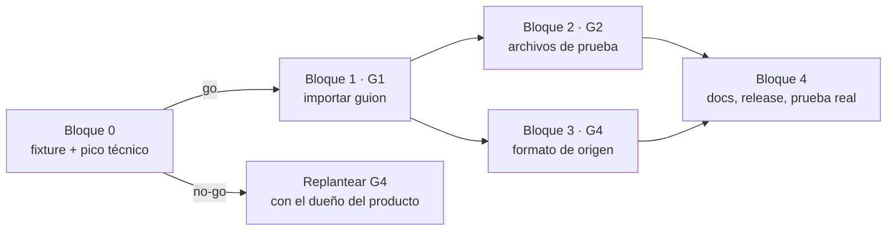

# G — Del guion de pruebas a las evidencias · `v1.3.0`

**Estado:** ✅ Contrato aprobado (2026-11-10). Bloque 0 cerrado con **go** (2026-11-10). Bloque 1 cerrado (2026-11-11): verificación automática y prueba de escritorio aprobadas. Sigue: Bloque 2.

**Depende de:** F1–F9a · **Spec:** [2026-11-10-guion-a-evidencias-design](../specs/2026-11-10-guion-a-evidencias-design.md) · **Planes:** uno por bloque, escrito al iniciar el bloque (ver «Orden»). Bloque 0: [2026-11-10-g0-fixture-y-pico](../plans/2026-11-10-g0-fixture-y-pico.md). Bloque 1: [2026-11-10-g1-importar-guion](../plans/2026-11-10-g1-importar-guion.md). Bloque 2: [2026-11-11-g2-archivos-de-prueba](../plans/2026-11-11-g2-archivos-de-prueba.md).

## Objetivo
El tester importa el guion de pruebas del cliente en Excel, adjunta a cada caso su archivo de prueba, ejecuta a mano con `Ctrl+Alt+S` y devuelve **el mismo archivo del cliente** con los resultados escritos y una hoja «Evidencias» añadida. Caso de referencia: el guion de un cliente real (se omite su nombre).

## Alcance
| Entra | Fuera |
|---|---|
| Importar guion `.xlsx` con asistente de 3 pasos, perfil reutilizable y copia del archivo de origen (G1) | Importar `.xls`, Word o PDF como guion |
| Archivos de prueba por caso, en paquetes `.qapture` y respaldos (G2) | Documentos fuente del proyecto (ODT, análisis) |
| Exportar al formato de origen: valores en celdas + hoja «Evidencias» (G4, opción a) | Anexos Word/PDF o carpeta de imágenes |
| Casilla «Condicionado» y equivalencia de estados por perfil | Estado nuevo en Qapture |
| | Plan por caso, corridas, estado «Propuesto» (G3), herramientas MCP nuevas, puente con Tija (G5) |
| | Fusionar un import sobre un proyecto existente; corregir validaciones del archivo del cliente |

## Orden

El bloque 0 va primero porque el trasplante de la hoja con imágenes (D10) es el mayor riesgo técnico. G2 y G4 pueden avanzar en paralelo una vez cerrado G1.

## Tasks

### Bloque 0 · Base de pruebas y pico técnico
| ID | Task | Qué entrega | Estado |
|---|---|---|---|
| G-T1 | Fixture sintético de guion | Helper de pruebas que genera un `.xlsx` con la forma del guion de referencia: carátula filas 1–12, encabezados fila 15, 36 casos, celdas combinadas, validación de datos en filas 16–35 con «Crìtico», hoja oculta, autofiltro `A15:M15`, área de impresión, logo. Sin datos reales | ✅ 2026-11-10 |
| G-T2 | Pico: trasplante de hoja «Evidencias» | Prototipo de D10 sobre el fixture: hoja generada con `rust_xlsxwriter` (2 imágenes) injertada en el libro; el resultado abre sin reparación en Excel y LibreOffice. Nota de resultado (go / no-go) en el handoff | ✅ 2026-11-10 · **go** ([pico-trasplante](../handoffs/g0/pico-trasplante.md)) |

### Bloque 1 · G1 Importar guion
| ID | Task | Qué entrega | Estado |
|---|---|---|---|
| G1-T1 | Lector de guion | `calamine` a dependencias de producción; `transfer/guion/read.rs`: hojas visibles, celdas como texto, fechas como fecha, fila de encabezados sugerida | ✅ 2026-11-11 |
| G1-T2 | Perfil de importación | `transfer/guion/profile.rs`: tipos del JSON v1 (spec §5), validación, aplicación del mapeo, equivalencia de estados D4 sin acentos ni mayúsculas, normalización de listas («Crìtico» → «Crítico») | ✅ 2026-11-11 |
| G1-T3 | Migración 0007 y repositorios | `0007_guion.sql` con `import_profile`, `project_source`, `case_source`, `case_fixture`; repositorio de perfiles (crear, listar, borrar; sin renombrar, P4) y de origen | ✅ 2026-11-11 |
| G1-T4 | Vista previa | Casos que se crearán y avisos: filas vacías, códigos vacíos o repetidos, valores fuera de lista, estados desconocidos; detección de carátula D8 | ✅ 2026-11-11 |
| G1-T5 | Importar todo o nada | Proyecto, campos (incluida la casilla «Condicionado»), casos, valores, `case_source` y copia del `.xlsx` con `sha256`, en una transacción; perfil guardado si se pidió | ✅ 2026-11-11 |
| G1-T6 | Comandos y contrato | `guion_inspect`, `guion_preview`, `guion_import`, `import_profiles_list`, `import_profile_delete`; permisos en la capability; DTO y test de contrato Rust ↔ TS | ✅ 2026-11-11 |
| G1-T7 | Puerto y estado | `GuionImporter` (memoria y Tauri), casos de uso y slice | ✅ 2026-11-11 |
| G1-T8 | Asistente «Importar guion de pruebas…» | Pantalla de 3 pasos en el menú Datos (spec §6) | ✅ 2026-11-11 |

### Bloque 2 · G2 Archivos de prueba
| ID | Task | Qué entrega | Estado |
|---|---|---|---|
| G2-T1 | Almacén de archivos de prueba | `media/fixtures.rs`: guardar, listar, quitar; extensiones y 25 MB de D12; `sha256`; solo lectura | ☐ |
| G2-T2 | Comandos | `fixture_add`, `fixture_list`, `fixture_remove`, `fixture_reveal`, `fixture_copy_path`; permisos; contrato | ☐ |
| G2-T3 | Paquetes y respaldos | Paquete `.qapture` formato 2 con origen del guion y archivos de prueba; sigue leyendo formato 1. Los respaldos y la restauración incluyen los archivos | ☐ |
| G2-T4 | Interfaz | Puerto `FixtureStore`, slice y sección «Archivos de prueba» en el detalle del caso (agregar, arrastrar, mostrar en carpeta, copiar ruta, quitar) | ☐ |

### Bloque 3 · G4 Formato de origen
| ID | Task | Qué entrega | Estado |
|---|---|---|---|
| G4-T1 | Escritura de celdas | `excel/origin/cells.rs`: texto en línea, fecha con el estilo existente, celda o fila inexistente creada en orden, fórmula quitada (D9) | ☐ |
| G4-T2 | Valores por fila | Estado con el vocabulario del perfil (D6), fecha y tester (D7), Condiciones con «Bloqueado: …», carátula (D8); escribe por `case_source.row` | ☐ |
| G4-T3 | Hoja «Evidencias» | `excel/origin/evidence_graft.rs` a partir del pico G-T2: una sección por caso ejecutado, imágenes con descripción; nombre alternativo si ya existe la hoja | ☐ |
| G4-T4 | Exportación completa | `excel/origin/mod.rs` y la prueba de ida y vuelta parte por parte del ZIP (criterio de éxito 2 del spec) | ☐ |
| G4-T5 | Comando | `export_origin`: valida copia y `sha256`, diálogo de guardar con sufijo `_ejecutado`, aviso de datos personales, sin sobrescribir sin confirmación; contrato | ☐ |
| G4-T6 | Interfaz | Opción «Formato de origen» en el diálogo de exportar, solo en proyectos importados (spec §6) | ☐ |

### Bloque 4 · Cierre
| ID | Task | Qué entrega | Estado |
|---|---|---|---|
| G-T3 | Documentación y release | `docs/usuario/uso.md` (importar guion, archivos de prueba, formato de origen), `CHANGELOG.md`, versión 1.3.0, tabla de contratos (F8c → v1.4, F8d → v1.5) | ☐ |
| G-T4 | Prueba real y checklist | Ida y vuelta con el guion real del cliente **en local** (no se versiona) y checklist firmado | ☐ |

## Trabajo fuera del código (orden de trabajo de referencia)

No bloquea las tasks, pero sí la entrega al cliente.

| # | Tarea | Depende de |
|---|---|---|
| O1 | Confirmar con el cliente: acceso y usuario de prueba (D1, D2), si la tabla se restablece (D6), datos a tapar y nombre de capturas (C7, C8), «Aceptado» vs «Aprobado» (C1) | — |
| O2 | Fabricar los 15 archivos de prueba F01–F15 a partir del anexo de datos del cliente (documento 04 de la propuesta), con fechas calculadas al momento para los casos que escriben | — |
| O3 | Importar el guion en Qapture y asociar F01–F15 a sus casos | G1, G2 |
| O4 | Ejecutar los 36 casos en el ambiente de pruebas en orden de dependencias (CP23 antes que CP36; CP21 y CP22), con `Ctrl+Alt+S`; CP02/CP03 por hoja; RN16–RN24 anotadas en Condiciones | O1, O3 |
| O5 | Exportar el guion ejecutado, revisar capturas y entregar | G4, O4 |

O4 puede empezar con G1 y G2 listos: las evidencias quedan en Qapture y G4 solo las escribe al final.

## Interfaces producidas
G1 produce el perfil JSON v1 (`ProfileDefinition`, columnas, destinos, roles, estados y carátula), los DTO de inspección/vista previa/importación, los cinco comandos Tauri y el puerto `GuionImporter` con adaptadores Tauri y memoria. El asistente se conecta mediante un token; el webview no envía rutas.

| Tabla de G1 | Datos conservados |
|---|---|
| `import_profile` | Nombre único sin distinguir mayúsculas y definición JSON versionada |
| `project_source` | Archivo, ruta guardada, `sha256`, hoja, fila de encabezados, `profile_id`, fecha y **`definition TEXT NOT NULL`**: copia de la definición usada, aunque no se guarde el perfil o se borre después (P1). `profile_id` usa `ON DELETE SET NULL` |
| `case_source` | Fila de origen por caso, independiente de cambios al código |

La migración 0007 también prepara `case_fixture`; su funcionalidad corresponde a G2.

## Criterios de aceptación
- [x] **G-T1–T2:** el fixture reproduce la estructura del spec §8; el libro con la hoja injertada abre sin reparación (verificado a mano en Excel y LibreOffice) y `calamine` lee sus dos hojas.
- [x] **G1** (pruebas automáticas y de escritorio, 2026-11-11; ver [tarea 8](../handoffs/g1/tarea-8.md)): importar el fixture produce 36 casos con 13 columnas; códigos repetidos o vacíos bloquean el import; «Crìtico» se normaliza; un estado desconocido entra como «No ejecutado» con el original en Condiciones; el perfil guardado importa un segundo guion sin mapear; un fallo a mitad no deja nada en la base ni en disco.
- [ ] **G2:** extensión no permitida y archivo de más de 25 MB se rechazan; los archivos sobreviven a exportar e importar un paquete y a restaurar un respaldo; un paquete de formato 1 se sigue importando.
- [ ] **G4:** ida y vuelta: solo cambian las celdas destino y se agregan la hoja y sus partes; las columnas I, K, L y M quedan llenas según D6 y D7; «Condicionado» se escribe cuando la casilla está activa; copia faltante o con otro `sha256` deshabilita la opción.
- [ ] Contrato Rust ↔ TS de todos los comandos nuevos; `cargo fmt --check`, `clippy -D warnings`, `cargo test`, lint, typecheck y Vitest en verde.

## Mensajes fijos
- `El archivo no es un libro de Excel (.xlsx) válido.`
- `El archivo está protegido con contraseña. Quita la protección y vuelve a intentar.`
- `No se encontró la fila de encabezados. Elígela a mano.`
- `Falta asignar la columna del código del caso.`
- `Hay códigos repetidos: <lista>.` · `Hay filas sin código: <filas>.`
- `«<valor>» no es un estado del perfil; el caso entra como «No ejecutado».`
- `El archivo de prueba supera 25 MB.` · `Ese tipo de archivo no se acepta como archivo de prueba.`
- `No se encontró el guion original de este proyecto. Vuelve a importarlo para exportar en su formato.`
- `El guion original cambió desde que se importó.`

## Checklist de pruebas locales
| # | Prueba | Esperado | OK |
|---|---|---|---|
| 1 | Importar el guion real del cliente | 36 casos y 13 columnas en menos de un minuto, sin editar el archivo | ☐ |
| 2 | Guardar el perfil e importar el mismo guion otra vez | Entra con el perfil, sin mapear | ☐ |
| 3 | Adjuntar F01–F15 y exportar/importar un paquete | Los archivos siguen en sus casos | ☐ |
| 4 | Restaurar un respaldo | Archivos de prueba y origen del guion intactos | ☐ |
| 5 | Ejecutar 3 casos con `Ctrl+Alt+S` (uno Aprobado, uno Fallido, uno Condicionado) y exportar en formato de origen | Abre en Excel sin reparación; I, K, L, M correctas; hoja «Evidencias» con las capturas | ☐ |
| 6 | Abrir el exportado en LibreOffice | Sin aviso; logos, combinaciones, validaciones, autofiltro y área de impresión intactos | ☐ |
| 7 | Borrar la copia del guion en la carpeta de datos y abrir «Exportar» | «Formato de origen» deshabilitado con el mensaje fijo | ☐ |
