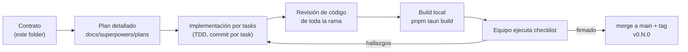

# Contratos por fase — Qapture v1

Cada fase es un contrato entre desarrollo y el equipo QA de Teams4Soft:

1. **Alcance:** los casos de uso del [spec](../specs/2026-10-15-qapture-design.md) que entran y los que no.
2. **Tasks:** la lista controlada de trabajo. El detalle paso a paso está en el plan de la fase (`../plans/`), que se escribe al **iniciar** la fase, cuando ya existen las interfaces de las fases previas.
3. **Interfaces producidas:** lo que las fases siguientes pueden usar sin romper nada.
4. **Criterios de aceptación:** lo que verifican los tests automáticos.
5. **Checklist de pruebas locales:** lo que el equipo prueba a mano con el build de la fase. **La fase se cierra cuando el checklist está firmado.**

## Flujo de una fase



## Estado

| Fase | Contrato | Plan | Estado | Tag |
|---|---|---|---|---|
| F0 | [Scaffold + repo + spec](F0-scaffold.md) | — | ✅ Cerrada | — |
| F1 | [Dominio + SQLite + CRUD](F1-dominio-datos-crud.md) | [plan](../plans/2026-10-15-f1-dominio-datos-crud.md) | ✅ Cerrada | `v0.1.0` |
| F2 | [Evidencias + editor de anotaciones](F2-evidencias-anotaciones.md) | [plan](../plans/2026-10-15-f2-evidencias-anotaciones.md) | ✅ Cerrada | `v0.2.0` |
| F3 | [Captura integrada](F3-captura-integrada.md) | [plan](../plans/2026-10-16-f3-captura-integrada.md) | ✅ Cerrada | `v0.3.0` |
| F4 | [Excel con carátula](F4-excel-caratula.md) | [plan](../plans/2026-10-16-f4-excel-caratula.md) | 🧪 En pruebas del equipo | `v0.4.0` |
| F5 | [Importación v1 + paquetes + respaldo](F5-importacion-paquetes.md) | [plan](../plans/2026-10-16-f5-importacion-paquetes.md) | 🧪 En pruebas del equipo | `v0.5.0` |
| F6 | [Bandeja, atajos y settings](F6-bandeja-atajos-settings.md) | [plan](../plans/2026-10-17-f6-bandeja-atajos-settings.md) | 🧪 En pruebas del equipo | `v0.6.0` |
| F7 | [CI/CD, updater, release y docs](F7-cicd-release.md) | [plan](../plans/2026-10-17-f7-cicd-release.md) | 🧪 En pruebas del equipo | `v1.0.0` |

**Orden:** F1 → F2 → F4 → F6 → F7 forma el **MVP**; F3 y F5 pueden ir antes o después de F7 según la presión del equipo. F4 solo depende de F1, así que puede ir en paralelo a F2.

## Cómo probar un build local (F1–F6)

Mientras F7 no automatice los releases:

```bash
git pull && pnpm install
pnpm tauri build
# instalador: src-tauri/target/release/bundle/nsis/Qapture_<versión>_x64-setup.exe
```

El desarrollador comparte ese `.exe` por Teams/OneDrive. Los datos de prueba quedan en `%APPDATA%\com.teams4soft.qapture\`; para empezar de cero, cierra la app y borra esa carpeta.
