# Qapture — Spec de diseño v1

> **Qapture** (QA + *capture*) · Ecosistema Teams4Soft
> Fecha: 2026-10-15 · Estado: **borrador para revisión**
> Reemplaza a: "Bitácora local" (`evidencias/app-local`, Node + HTML vanilla + CMD)

---

## 1. Contexto: qué existe hoy (Bitácora local v1)

| Pieza | Comportamiento actual | Problema para el largo plazo |
|---|---|---|
| `Abrir Bitacora.cmd` + `launcher.mjs` | Exige Node instalado, ejecuta `npm install`, lanza servidor HTTP `127.0.0.1:4318` y abre el navegador | No es distribuible al equipo; depende de Node y de un puerto libre |
| `server.mjs` | `GET/PUT /api/state` (estado completo, revisión optimista), `GET /api/export` | Guarda todo el estado en cada cambio |
| `store.mjs` | Un `matrices.json` (+`.bak`, escritura atómica), validación estricta, imágenes **base64 dentro del JSON**, tope 150 MB | No escala con muchas capturas |
| `export.mjs` | ExcelJS: hoja *Matriz* (14 columnas **fijas**), hoja *Evidencias* con imágenes y vínculos ida/vuelta, estados con color y lista desplegable | Sin carátula, sin branding Teams4Soft, columnas no configurables |
| `public/` | UI vanilla: proyectos, casos, Ctrl+V de capturas, duplicar ejecución, filtros, respaldo/importación JSON, plantilla vacía | Difícil de mantener/extender |

**Se conserva (comportamiento probado):** una fila por ejecución y entorno (`EJ-###`), duplicar ejecución, pegar captura con Ctrl+V, descripción obligatoria por captura, hoja de evidencias con vínculos "Ver evidencias / Volver a la matriz", seis estados con colores, respaldo e importación sin sobrescribir.

**Branding disponible** (extraído de `informes/*.docx`): logo *Teams4Soft · Inteligencia Híbrida*, banner de red de nodos y paleta:

| Token | Hex | Uso |
|---|---|---|
| `t4s-blue` | `#2B629E` | Encabezados, bandas, botones primarios |
| `t4s-lime` | `#BAC82D` | Acentos, KPI positivos, subrayados |
| `t4s-charcoal` | `#292B2D` | Texto principal |
| `t4s-cream` | `#F6F4F1` | Fondos de tabla / filas alternas |
| `t4s-gray` | `#596069` | Texto secundario, pies |
| Tipografía | Arial | Excel y documentos (segura en Office/WPS) |

## 2. Objetivo y criterios de éxito

**Objetivo:** que cualquier persona del equipo QA de Teams4Soft instale un `.exe`, tenga Qapture corriendo en segundo plano, lo invoque con un atajo, registre casos y capturas anotadas, y exporte un Excel con carátula Teams4Soft listo para entregar al cliente.

**Éxito significa:**
1. Instalación sin prerrequisitos (sin Node ni CMD), con instalador NSIS/MSI o versión portable.
2. Del atajo de captura a la evidencia anotada y guardada en menos de 15 segundos.
3. El Excel exportado abre sin advertencias en Excel y WPS e incluye carátula, matriz con columnas de la plantilla, evidencias y resumen.
4. Los datos de la v1 (`matrices.json` o respaldo JSON) se importan sin pérdida.
5. Las nuevas versiones llegan solas: el tag `vX.Y.Z` dispara el release y la app avisa e instala.

**No-objetivos v1:** servidor central, multiusuario en tiempo real, sincronización en la nube, macOS/Linux (el código queda portable, pero solo se publica Windows), edición del Excel de vuelta hacia la app.

## 3. Decisiones tomadas

| # | Decisión | Elección |
|---|---|---|
| D1 | Colaboración | **Local por equipo.** Se comparte el Excel o un paquete `.qapture` exportable/importable |
| D2 | Campos | **Plantillas de campos.** Biblioteca de plantillas por tipo de prueba; el proyecto copia la plantilla y puede ajustarla. Campos núcleo fijos |
| D3 | Carátula | Lo básico, más datos del proyecto, resumen de resultados y control de versiones |
| D4 | Distribución | **Repo público** `Ps3udoDev/qapture`, GitHub Releases, **auto-update firmado** |
| D5 | Atajos v1 | Mostrar/ocultar, pegar evidencia rápida, **captura integrada**, nuevo caso (todos configurables) |
| D6 | Arquitectura | **A+B:** React para todo lo visual (incluido el editor de anotaciones); Rust para captura, almacenamiento, archivos, Excel, bandeja, atajos y updater |
| D7 | Excel | Se genera en **Rust** con `rust_xlsxwriter` (robusto con cientos de imágenes, sin cargar el webview) |
| D8 | Persistencia | **SQLite** (`rusqlite`, bundled) para los datos estructurados. Imágenes como **archivos PNG** en el directorio de datos de la app |

## 4. Arquitectura

### 4.1 Vista de componentes

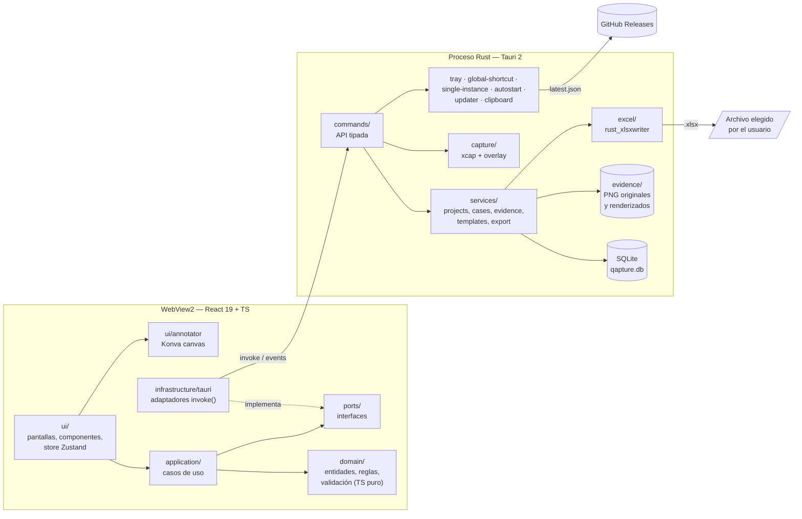

### 4.2 Responsabilidades

| Capa | Hace | No hace |
|---|---|---|
| `domain/` (TS) | Entidades, validación de valores de campo según su tipo, cálculo de resumen, generación de `EJ-###`, plantillas por defecto | I/O, React, Tauri |
| `application/` (TS) | Orquesta casos de uso (`createCase`, `attachEvidence`, `exportProject`…) a través de puertos | Conocer SQLite o el canvas |
| `ports/` (TS) | `ProjectRepository`, `EvidenceStore`, `TemplateRepository`, `Exporter`, `ScreenCapture`, `ClipboardImage`, `SettingsStore`, `Updater` | — |
| `infrastructure/tauri` | Implementa los puertos con `invoke()`. También hay `infrastructure/memory` para tests | Lógica de negocio |
| `ui/` | Pantallas, formularios dinámicos según la plantilla, editor de anotaciones | Validación de negocio (la delega al dominio) |
| Rust `commands/` | API pública mínima, validada con `serde`. Errores tipados `AppError` serializados | Lógica de UI |
| Rust `services/` | Transacciones SQLite, ciclo de vida de archivos, export, migraciones, importación legacy | — |

**Reglas:**
- `ui → application → domain`; `infrastructure` implementa `ports`; `domain` no importa nada externo.
- Rust revalida todo lo que llega por `invoke` (defensa en profundidad), porque el dominio TS no es la única barrera.
- Los tipos compartidos TS↔Rust se generan con **`specta` / `tauri-specta`** para que no se desincronicen.

### 4.3 Estructura del repositorio

```
qapture/
├─ src/
│  ├─ domain/          entities.ts, fields.ts, status.ts, summary.ts, templates/defaults.ts
│  ├─ application/     use-cases/*.ts
│  ├─ ports/           *.ts
│  ├─ infrastructure/  tauri/*.ts, memory/*.ts, bindings.ts (generado)
│  ├─ ui/              app/, screens/, components/, annotator/, settings/, theme/
│  └─ assets/brand/    t4s-logo.png, t4s-network-banner.png
├─ src-tauri/
│  ├─ src/
│  │  ├─ commands/     projects.rs, cases.rs, evidence.rs, templates.rs, export.rs, capture.rs, settings.rs, legacy.rs
│  │  ├─ services/     …
│  │  ├─ db/           mod.rs, migrations/0001_init.sql …
│  │  ├─ excel/        cover.rs, matrix.rs, evidence_sheet.rs, summary.rs, styles.rs
│  │  ├─ capture/      screen.rs, overlay.rs
│  │  ├─ system/       tray.rs, shortcuts.rs, updater.rs
│  │  ├─ error.rs  lib.rs  main.rs
│  ├─ capabilities/    main.json, overlay.json (permisos mínimos por ventana)
│  └─ tauri.conf.json
├─ docs/               usuario/, arquitectura.md, adr/, superpowers/specs|plans
└─ .github/workflows/  ci.yml, release.yml
```

## 5. Modelo de datos

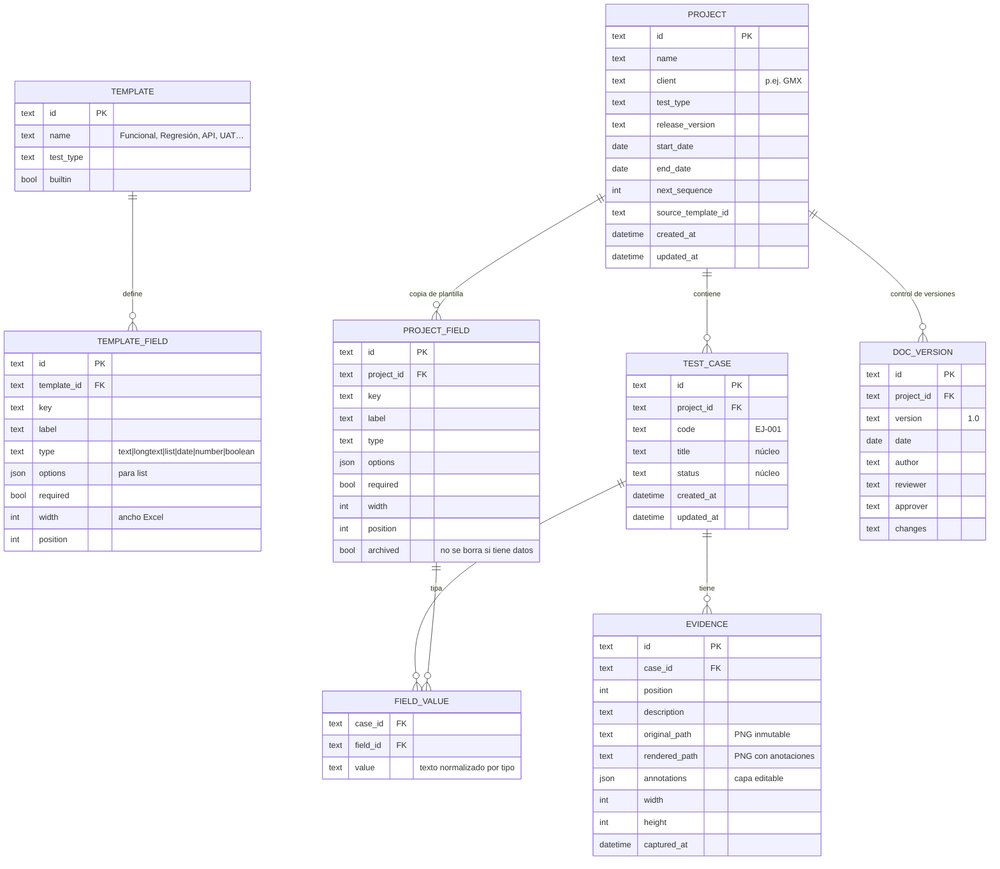

**Campos núcleo** (fijos en toda plantilla, no se pueden eliminar): `ID (EJ-###)`, `Caso de prueba`, `Estado`, `Evidencias` (calculado).

**Estados v1** (fijos, heredados de la v1): `No ejecutado`, `En ejecución`, `Por documentar`, `Aprobado`, `Fallido`, `Bloqueado`.

**Plantillas incluidas:**

| Plantilla | Campos (además de los núcleo) |
|---|---|
| **Funcional (por defecto)** | Entorno\*, Módulo, Menú, Submenú, Funcionalidad, Datos de entrada, Resultado esperado, Resultado obtenido, Fecha de ejecución, Responsable, Observaciones (equivale a la v1 + Observaciones) |
| Regresión | Entorno\*, Módulo, Versión probada, Caso origen, Resultado esperado, Resultado obtenido, Fecha, Responsable, Observaciones |
| API | Entorno\*, Endpoint, Método (lista), Request, Response esperado, Response obtenido, Código HTTP, Fecha, Responsable, Observaciones |
| UAT | Entorno\*, Proceso de negocio, Usuario clave, Pasos, Resultado esperado, Resultado obtenido, Aceptado (sí/no), Fecha, Observaciones |

**Reglas del modelo:**
- Un proyecto **copia** los campos de su plantilla. Editar la plantilla después no altera proyectos existentes.
- Un campo con datos no se elimina: se **archiva** (se oculta en UI y en Excel, sin perder valores). Un campo sin datos sí se elimina.
- Cambiar el tipo de un campo con datos solo se permite hacia `text` o `longtext`.

**Almacenamiento:** `%APPDATA%\com.teams4soft.qapture\` → `qapture.db` (modo WAL), `evidence/<project_id>/<evidence_id>.orig.png` y `.render.png`, `backups/` (copia automática diaria de la db, se conservan 7).

## 6. Casos de uso

### 6.1 Mapa general

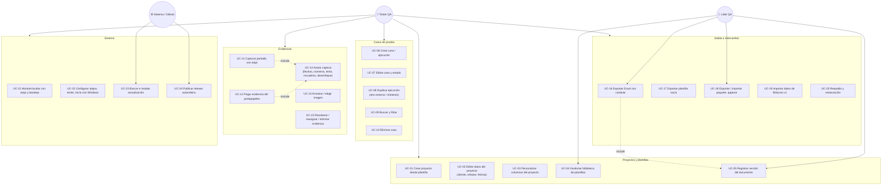

### 6.2 UC-11 Captura integrada con atajo (`Ctrl+Alt+S`)

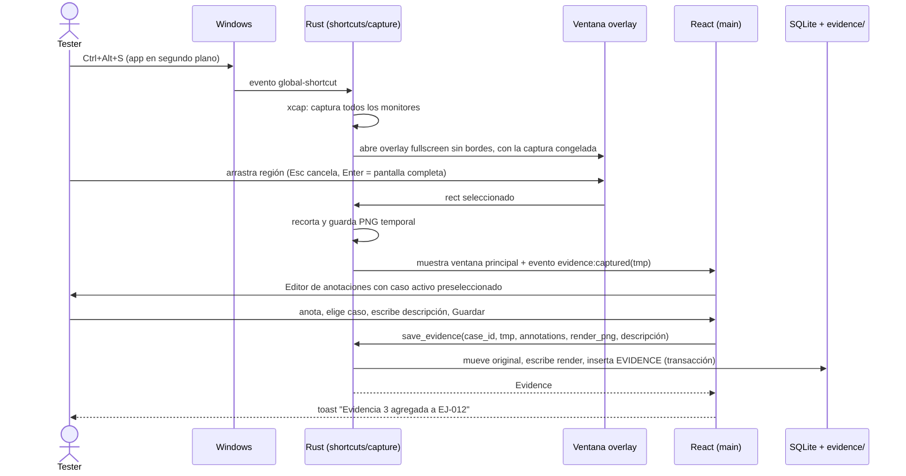

### 6.3 UC-12 Pegar evidencia rápida (`Ctrl+Alt+V`, tras `Win+Shift+S`)

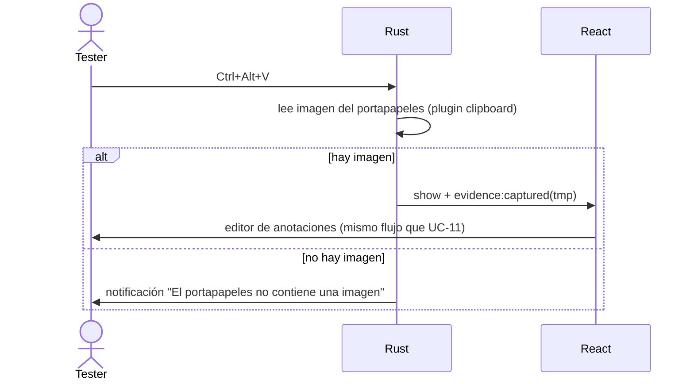

Dentro de la app, `Ctrl+V` sigue funcionando igual que en la v1 (atajo local, no global).

### 6.4 UC-14 Editor de anotaciones

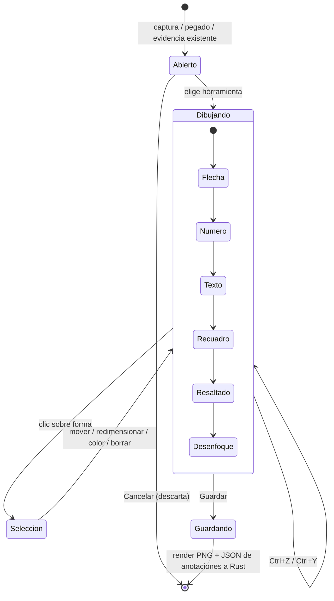

| Herramienta | Detalle |
|---|---|
| Flecha | Color (rojo por defecto, paleta T4S), grosor |
| Número | Marcadores circulares auto-incrementales ①②③. Su significado se describe en la descripción de la evidencia |
| Texto | Caja de texto con fondo semitransparente |
| Recuadro / elipse | Contorno para señalar campos o inputs |
| Resaltado | Rectángulo amarillo translúcido |
| Desenfoque / pixelado | Para ocultar datos sensibles del cliente (pólizas, importes, PII) |
| Recortar | Sobre el original, no destructivo |

**Implementación:**
- Front con **Konva / react-konva**.
- Las anotaciones se guardan como JSON vectorial sobre el PNG **original inmutable**, así que siempre se pueden reeditar.
- Al guardar, el front genera el PNG renderizado a resolución nativa (lo que se ve es lo que sale) y Rust lo persiste.
- El Excel usa siempre el renderizado.

### 6.5 UC-16 Exportar Excel con carátula

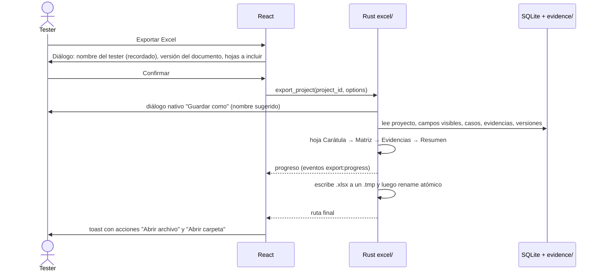

**Nombre sugerido:** `T4S_<Cliente>_<Proyecto>_Evidencias_<AAAAMMDD>_v<versión>.xlsx` (misma convención que los informes T4S).

### 6.6 UC-19 Importar Bitácora v1

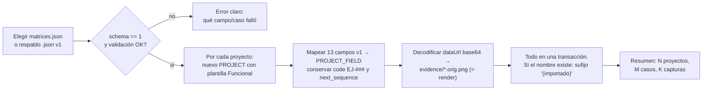

### 6.7 UC-18 Compartir proyecto con un compañero

Paquete **`.qapture`** = ZIP con `project.json` (schema versionado) y `evidence/*.png`. Importar crea siempre una **copia** y nunca sobrescribe, igual que en la v1.

### 6.8 UC-21 Ciclo de vida de la ventana (segundo plano)

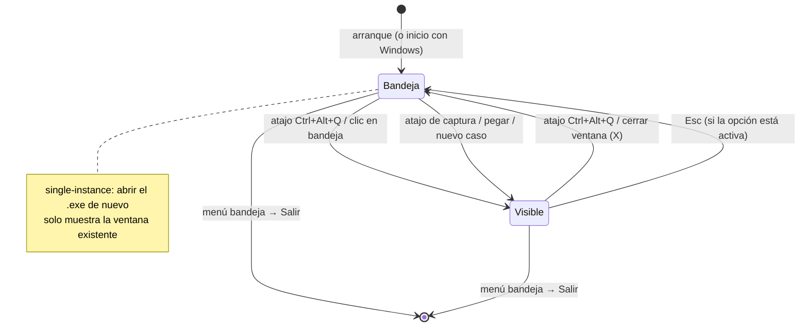

**Menú de bandeja:** Abrir Qapture · Capturar pantalla · Pegar evidencia · Nuevo caso · Buscar actualizaciones · Salir.

### 6.9 UC-22 Configuración

| Sección | Opciones |
|---|---|
| Perfil | Nombre del tester (se precarga en "Responsable" y en la carátula), cargo, correo opcional |
| Atajos | Grabador de combinaciones con detección de conflictos (si el SO rechaza el registro se muestra el error y se conserva el anterior). Valores por defecto: Mostrar/ocultar `Ctrl+Alt+Q` · Capturar `Ctrl+Alt+S` · Pegar evidencia `Ctrl+Alt+V` · Nuevo caso `Ctrl+Alt+N` |
| Sistema | Iniciar con Windows, cerrar = ocultar en bandeja, Esc oculta, tema claro/oscuro |
| Exportación | Carpeta por defecto, ancho máximo de imagen en Excel, incluir hoja Resumen |
| Datos | Ubicación de datos (abrir carpeta), respaldo ahora, restaurar, importar v1 |
| Acerca de | Versión, buscar actualizaciones, enlace a releases y documentación |

### 6.10 UC-23 / UC-24 Publicación y actualización

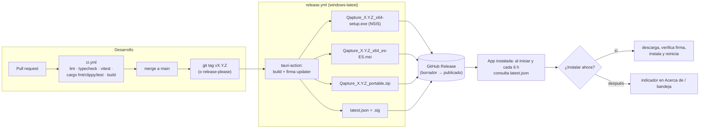

- Firma del updater: `TAURI_SIGNING_PRIVATE_KEY` y su contraseña en *GitHub Secrets*. La clave pública va en `tauri.conf.json`.
- **Portable:** un ZIP con `Qapture.exe`. Guarda los datos en `.\data` junto al exe si existe un archivo `portable.flag`. No se auto-instala: avisa y enlaza a la release.
- Windows SmartScreen va a advertir porque no hay firma de código Authenticode en la v1. Queda documentado en la guía de instalación; la firma Authenticode es una mejora futura.

## 7. Diseño del Excel exportado

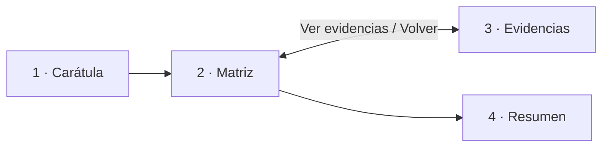

| Hoja | Contenido |
|---|---|
| **Carátula** | Banner de red de nodos (esquina superior), **logo Teams4Soft**, título "Matriz de pruebas y evidencias", bloque de datos (Cliente, Proyecto/Módulo, Tipo de prueba, Versión/Release probado, Entorno(s), Periodo inicio–fin, **Tester**, Fecha de generación), **KPI de resultados** (total de ejecuciones, por estado, % de éxito = Aprobado / ejecutados, nº de evidencias), tabla de **control de versiones** (Versión · Fecha · Elaborado · Revisado · Aprobado · Cambios) y pie "Teams4Soft · Inteligencia Híbrida · Confidencial" |
| **Matriz** | Encabezado azul `#2B629E` con texto blanco, columnas = campos visibles del proyecto en su orden y ancho, filas alternas crema `#F6F4F1`, lista desplegable de estado, formato condicional (Aprobado verde, Fallido rojo, Bloqueado amarillo), fechas `dd/mm/yyyy`, autofiltro, encabezados inmovilizados, impresión A4 horizontal ajustada al ancho |
| **Evidencias** | Por cada caso: banda con código y título, "Volver a la matriz", entorno y estado, campos clave (esperado/obtenido) y luego cada captura (descripción e imagen renderizada, ancho máximo configurable) |
| **Resumen** | Tabla por estado y por módulo/entorno (si existen esos campos) y un gráfico de barras nativo de Excel |

Todo en **Arial**. El logo y el banner van embebidos en el binario de la app (`include_bytes!`).

## 8. Manejo de errores

| Situación | Comportamiento |
|---|---|
| Error de comando Rust | `AppError { code, message_es, detail }` serializado. La UI muestra el mensaje en español y registra el detalle en el log (`tauri-plugin-log`, archivo rotado en el directorio de datos) |
| Atajo ya ocupado por otra app | Se notifica en Settings y en un toast al iniciar; se mantiene el resto de atajos |
| Disco lleno / permisos | Transacción revertida, archivos temporales limpiados, mensaje "Revisa el espacio disponible" |
| db corrupta al arrancar | Se abre en modo recuperación: ofrece restaurar desde `backups/` o importar paquete |
| Archivo Excel abierto por otro programa | "Cierra el archivo en Excel y vuelve a intentar" (se detecta el error de bloqueo de Windows) |
| Importación inválida | No escribe nada (todo o nada) y lista los primeros 10 problemas |
| Migraciones de esquema | Se versionan con `PRAGMA user_version`. Copia de seguridad automática antes de migrar |

## 9. Seguridad y privacidad

- **Sin red** salvo la consulta del updater a `github.com`. CSP estricta en `tauri.conf.json`.
- **Capabilities Tauri 2 mínimas** por ventana: el overlay solo puede emitir el rect seleccionado; la principal no tiene fs genérico, todo el I/O pasa por comandos propios con rutas validadas.
- **Repo público:** nunca se versionan datos de clientes. El `.gitignore` bloquea `*.db`, `data/`, `evidence/` y `*.xlsx`. Las semillas y los fixtures de prueba usan datos ficticios. Los datos de GMX de la v1 **no** se incluyen.
- La herramienta de desenfoque permite anonimizar capturas antes de exportar.

## 10. Estrategia de pruebas

| Nivel | Herramienta | Cubre |
|---|---|---|
| Dominio TS | Vitest | Validación por tipo de campo, `EJ-###`, resumen/KPI, reglas de plantilla (archivar vs eliminar) |
| Aplicación TS | Vitest + adaptadores `memory` | Casos de uso completos sin Tauri |
| UI | Vitest + Testing Library | Formulario dinámico por plantilla, editor de anotaciones (serialización) |
| Rust | `cargo test` | Repositorios SQLite (db en memoria), migraciones, importación legacy con el fixture v1 anonimizado, export: abrir el xlsx generado con `calamine` y verificar hojas, celdas, hipervínculos y nº de imágenes |
| E2E | WebdriverIO + `tauri-driver` (Windows) | Flujo feliz: crear proyecto → caso → pegar evidencia → exportar |
| Manual por release | Checklist en `docs/` | Abrir el Excel en Excel y WPS, atajos globales, bandeja, updater |

## 11. Fases (cada una con su propio plan de implementación)

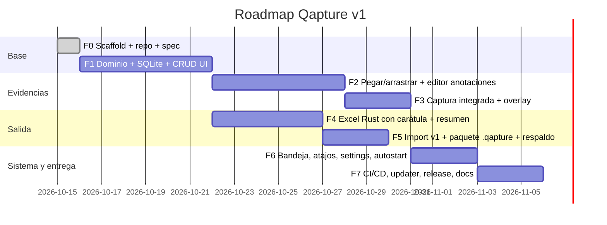

**MVP utilizable por el equipo = F1 + F2 + F4 + F6 + F7** (F3 y F5 pueden ir en v1.1 si hace falta acelerar).

## 12. Stack

| Área | Elección |
|---|---|
| Front | React 19, TypeScript, Vite, Zustand, React Router, react-hook-form + zod (formulario dinámico), react-konva, Tailwind CSS con tokens T4S |
| Core | Tauri 2, Rust 2024, rusqlite (bundled), rust_xlsxwriter, xcap, image, zip, serde, thiserror, specta / tauri-specta |
| Plugins Tauri | global-shortcut, single-instance, autostart, updater, process, dialog, clipboard-manager, notification, log, opener |
| Calidad | ESLint, Prettier, Vitest, rustfmt, clippy, WebdriverIO |
| Entrega | GitHub Actions + `tauri-apps/tauri-action`, NSIS + MSI + ZIP portable |

## 13. Preguntas abiertas (no bloquean F1)

1. **Licencia** del repo público: MIT o "todos los derechos reservados Teams4Soft". El logo es marca registrada, así que conviene aclararlo en `NOTICE`.
2. ¿El repo se mueve después a una organización GitHub `teams4soft`? Afecta la URL del updater; se puede migrar con un release puente.
3. Ícono de la app: derivarlo del isotipo (la cabeza) de Teams4Soft o diseñar uno propio de Qapture.
