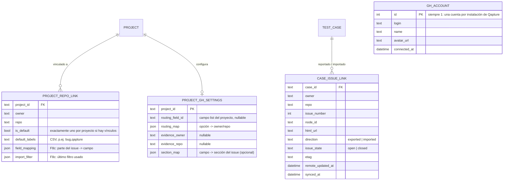

# Spec: integración con GitHub (F8)

> Estado: **borrador para aprobación** · Fecha: 2026-10-19
> Origen: [propuesta 2026-10-19](../../propuestas/2026-10-19-integracion-github.md). Este spec la convierte en decisiones; donde no dice nada nuevo, vale lo de la propuesta (diagramas de secuencia, tabla de parseo, límites de la API).
> Entregas: **F8a + F8b → v1.1**, **F8c → v1.3**, **F8d → v1.4** (corrido el 2026-10-29: v1.2 es el [servidor MCP, F9](2026-10-29-mcp-design.md)).

Marcas usadas en el documento:
- **(decidido)**: lo decidió el dueño del producto en la conversación de diseño.
- **(llamada del diseño)**: no se discutió; es una decisión razonable que se puede revisar sin rehacer el resto.

---

## 1. Intención

Qapture es una app de escritorio local (Tauri 2, Windows y Linux) para documentar pruebas con evidencias. Hoy el resultado de una prueba termina en un Excel. Cuando el tester encuentra un fallo, lo vuelve a escribir a mano como issue en GitHub y pega las capturas una por una.

F8 conecta Qapture con GitHub para que:

1. El tester conecte **su propia cuenta** de GitHub desde Ajustes.
2. Un proyecto de Qapture se vincule a **uno o varios repos** (personales o de una organización, públicos o privados) a los que el tester tenga acceso.
3. Desde **cualquier caso** se cree un issue en el repo que corresponda, con los datos del caso y las **capturas anotadas embebidas**.
4. Los issues de un repo se importen como casos de prueba de una matriz.
5. Más adelante, el estado de casos e issues vinculados se mantenga al día.

Todo **sin backend propio** **(decidido)**: la app habla directo con `api.github.com` desde el proceso Rust.

### Escenario real que tiene que funcionar

- Repo de pruebas personal: `Ps3udoDev/booknow-mcp-service`.
- Organización `TEAMS4SOFT` (privada) con un front central y APIs por módulo: `GMX-frontend`, `GMX-CommonAPI`, `GMX-ClaimsAPI`…
- En **la misma matriz**, el caso EJ-014 genera un issue en `GMX-frontend` y el EJ-015 uno en `GMX-ClaimsAPI`. Un mismo caso puede generar issues en ambos si el fallo es de los dos.
- Las capturas van a `TEAMS4SOFT/qa-evidencias` (privado, sin protecciones de rama).
- Otro dev de la org instala la actualización, conecta su cuenta y ve solo los repos de la org a los que tiene acceso y donde la App está instalada.

### Criterios de éxito

- Desde un caso con 3 capturas, crear un issue en `GMX-frontend` con las imágenes visibles para cualquier miembro de la org con acceso: **un diálogo, un clic de confirmación**.
- Si no se puede subir al repo de evidencias, el issue se crea igual y el tester termina de pegar las imágenes con Ctrl+V guiado (modo asistido).
- Un dev nuevo pasa de «instalé la versión» a «creé mi primer issue» siguiendo solo la guía de `docs/usuario/`.
- El token nunca aparece en el WebView, en `qapture.db`, en respaldos ni en paquetes `.qapture`.

## 2. Objetivos, no objetivos y anti-objetivos

**Objetivos**
- Conexión con GitHub por Device Flow (F8a).
- Proyecto ↔ varios repos, con uno predeterminado y ruteo opcional por columna (F8a).
- Caso → issue con evidencias en un repo dedicado, con modo asistido como respaldo (F8b).
- Comentar en un issue ya vinculado (re-test) (F8b).
- Columna «Issue» en el Excel (F8b).
- Issues → casos con filtros, mapeo y vista previa (F8c).
- Refresco de estado con ETag y cierre/reapertura con confirmación (F8d).
- Guía de usuario, guía para el admin de la organización y ADR 0005.

**No objetivos (este spec)**
- Backend, Supabase, webhooks o sincronización entre equipos.
- GitHub Enterprise Server. Solo `github.com` **(decidido)**. La URL base de la API queda en **una sola constante** de Rust para no cerrar la puerta **(llamada del diseño)**.
- GitLab, Azure DevOps o Jira. El puerto `IssueTracker` queda listo para ellos, pero no se implementan.
- Sugerir casos con IA.
- Descargar las imágenes de los issues al importar.
- Transferir la GitHub App a la organización (se verá después).
- Subir capturas a una rama del repo del producto (opción 1 de la propuesta) o a almacenamiento externo.

**Anti-objetivos (sería un fracaso aunque «funcione»)**
- Que el token llegue al WebView, a la base, a un respaldo o a un paquete.
- Que se suba un PNG **original** (sin blur) en lugar del renderizado.
- Que Qapture escriba archivos en un repo que no sea el de evidencias configurado, aunque el permiso de la App lo permita.
- Que se cierre, reabra o edite un issue sin confirmación explícita del tester.
- Que se dupliquen issues del mismo caso en el mismo repo, o casos al reimportar el mismo issue.
- Que reportar un issue cambie el estado del caso.
- Imitar el Ctrl+V de github.com usando la cookie de sesión del navegador o endpoints internos.

## 3. Decisiones

| # | Decisión | Origen |
|---|---|---|
| D1 | Sin backend. **GitHub App** con **Device Flow**; el `client_id` va embebido; no hay `client_secret` | decidido |
| D2 | La App se registra **pública** bajo la cuenta personal **`Ps3udoDev`**. La transferencia a TEAMS4SOFT queda para después | decidido |
| D3 | Permisos de la App: Metadata **R**, Issues **R/W**, Contents **R/W**. Sin webhook | llamada del diseño (Contents lo exige D6) |
| D4 | Tokens de usuario **sin expiración** (se desactiva «Expire user authorization tokens» en la App). Ante un 401 se vuelve a pedir el Device Flow. Así no hace falta `client_secret` para refrescar | llamada del diseño |
| D5 | Un proyecto se vincula a **varios repos**, con uno **predeterminado**. Ruteo opcional: una columna de tipo lista del proyecto, con mapeo `opción → repo` | decidido |
| D6 | Las capturas se suben a un **repo de evidencias dedicado** (`TEAMS4SOFT/qa-evidencias`) configurado por proyecto (opción 2 de la propuesta) | decidido |
| D7 | Ruta: `<proyecto>/<caso>/<fecha>_<tester>/<n>.png`, **un commit por reporte**, directo a la rama predeterminada del repo de evidencias | decidido (orden de carpetas: llamada del diseño) |
| D8 | Si la subida no es posible, **modo asistido**: el issue se crea con el texto y el tester pega las capturas con Ctrl+V guiado (opción 3) | decidido |
| D9 | «Reportar en GitHub» está disponible en **cualquier estado** y **no cambia el estado** del caso | decidido |
| D10 | Un caso puede tener issues en varios repos: **como máximo uno por (caso, repo)** | decidido |
| D11 | El token vive en el **llavero del sistema operativo** (crate `keyring`): Credential Manager en Windows, Secret Service en Linux. **Nunca** se guarda en archivo | llamada del diseño (la propuesta solo contemplaba Windows) |
| D12 | Las llamadas a GitHub salen solo de Rust (`reqwest` + rustls). El CSP del WebView no cambia | propuesta |
| D13 | Solo `github.com` | decidido |

## 4. Prerrequisitos fuera del código

### 4.1 Registrar la GitHub App (lo hace Ps3udoDev, una vez)

`github.com` → foto de perfil → **Settings → Developer settings → GitHub Apps → New GitHub App**:

| Campo | Valor |
|---|---|
| Name | `Qapture` (si está ocupado, `Qapture QA` u otro; el *slug* resultante se guarda en la constante de §5.1) |
| Homepage URL | URL del repo de Qapture |
| Callback URL | vacío |
| Expire user authorization tokens | **desmarcado** (D4) |
| Request user authorization (OAuth) during installation | desmarcado |
| Enable Device Flow | **marcado** |
| Webhook → Active | **desmarcado** |
| Repository permissions | Metadata: Read-only · Issues: Read and write · Contents: Read and write |
| Organization / Account permissions | ninguno |
| Where can this GitHub App be installed? | **Any account** (pública, para poder instalarla en TEAMS4SOFT) |

Después se anota el **Client ID** (no el App ID) y el **slug** que aparece en `https://github.com/apps/<slug>`. No se genera client secret. GitHub pide generar una **private key** para poder instalar la App: se genera, se guarda fuera del repo (en un gestor de contraseñas) y **Qapture no la usa nunca**, porque el Device Flow no la necesita.

**Estado (2026-10-19):** App registrada como **`qapture-qa`** (`https://github.com/apps/qapture-qa`), Client ID **`Iv23liai2kBF7qDefVd8`** (público, va en `config.rs`). Ps3udoDev es *member* de TEAMS4SOFT, así que la instalación en la org la aprueba el owner (flujo «Request» de §4.2).

### 4.2 Instalar la App en la organización (guía para el admin)

Esto va en `docs/usuario/github-admin.md`, escrito para una persona que no conoce Qapture:

1. Ir a `https://github.com/apps/<slug>` → **Install** (o **Configure**, si ya está instalada).
2. Elegir la cuenta **TEAMS4SOFT**.
3. Elegir **Only select repositories** y marcar los repos del producto (`GMX-frontend`, `GMX-CommonAPI`, `GMX-ClaimsAPI`…) **y** `qa-evidencias`.
4. Revisar los permisos y pulsar **Install**.
5. En `qa-evidencias` → **Settings → Collaborators and teams**, dar **Read** al equipo de desarrollo (o confirmar que el permiso base de la org ya da lectura). Sin esto, quien lea el issue verá las imágenes rotas.

La guía explica en lenguaje simple qué se aprueba:
- **Issues (lectura y escritura):** crear y comentar issues en nombre del usuario que usa Qapture.
- **Contents (lectura y escritura):** GitHub no permite dar este permiso solo para `qa-evidencias`; se aplica en todos los repos seleccionados. **Qapture solo escribe en el repo de evidencias que se configure en cada proyecto y rechaza cualquier otro destino** (§7.4). Además, cada acción está limitada por los permisos del usuario: nadie puede hacer con Qapture algo que no pueda hacer ya en GitHub.

**Si quien instala no es owner:** el paso 4 muestra **Request** en lugar de **Install**. El owner recibe la solicitud y la aprueba en **TEAMS4SOFT → Settings → Third-party Access → GitHub Apps → Pending requests** (también puede llegar por correo). La guía incluye cómo saber si eres owner: **TEAMS4SOFT → People**, columna *Role*.

**Agregar un repo más adelante:** **TEAMS4SOFT → Settings → GitHub Apps → Qapture → Configure → Repository access**.

> Los nombres exactos de los menús de GitHub cambian con el tiempo. Quien escriba la guía la verifica contra la interfaz real el día que se escriba.

## 5. Arquitectura

La propuesta (§2) ya describe las capas: puerto `IssueTracker` en TS, adaptador Tauri con `zod`, y en Rust `integrations/github/` + `commands/integrations.rs`. Este spec mantiene esa estructura y la ajusta así:

### 5.1 Rust (`src-tauri/src/integrations/github/`)

| Archivo | Responsabilidad |
|---|---|
| `config.rs` | Constantes: `API_BASE = "https://api.github.com"`, `WEB_BASE = "https://github.com"`, `CLIENT_ID`, `APP_SLUG`, `User-Agent: Qapture/<versión>`, versión de API (`X-GitHub-Api-Version`) |
| `auth.rs` | Device Flow (`start` / `poll`), guardar/leer/borrar el token en el llavero, `GET /user` |
| `client.rs` | Cliente `reqwest` (rustls); errores HTTP → `AppError`; manejo de rate limit (`Retry-After`, `x-ratelimit-*`); `If-None-Match`/ETag (F8d) |
| `repos.rs` | `GET /user/installations` + `GET /user/installations/{id}/repositories` (paginado); permisos efectivos del repo (`permissions` del usuario) |
| `issues.rs` | Crear, comentar, listar (paginado, descarta `pull_request`), obtener, cerrar y reabrir |
| `evidence_upload.rs` | Subida de PNG en un commit con la API de Git de bajo nivel (§7.3); valida que el destino sea el repo de evidencias del proyecto |

Más:
- `repo/integrations.rs` + migración `0005_integrations.sql` (§6).
- `commands/integrations.rs`. Cada comando va en `names.rs`, `generate_handler!` y `capabilities/main.json`, como pide la arquitectura.
- `AppError` suma los códigos `gh_auth` (sin cuenta o token inválido), `gh_forbidden`, `gh_not_found`, `gh_rate_limited`, `gh_offline`, `gh_keyring` (llavero no disponible), `gh_conflict` (ya existe un issue para ese caso y repo) y `gh_validation` (422 de GitHub), todos con mensaje en español.

**Llavero (D11):** servicio `com.teams4soft.qapture`, cuenta `github`. En Linux, si no hay Secret Service disponible (por ejemplo, un escritorio mínimo sin gnome-keyring/kwallet), la conexión falla con `gh_keyring` y el mensaje explica qué instalar. **No hay respaldo en archivo** **(llamada del diseño)**. Modo portable: el token sigue en el llavero del usuario del sistema y no en `data\`.

### 5.2 Comandos

| Comando | Fase | Entrada → salida |
|---|---|---|
| `gh_connect_start` | a | — → `{ userCode, verificationUri, expiresIn, interval }` (el `device_code` se queda en Rust) |
| `gh_connect_cancel` | a | — → — |
| `gh_account` | a | — → `GhAccount \| null` (login, nombre, avatar, fecha) |
| `gh_disconnect` | a | — → — (borra el token y la fila `gh_account`) |
| `gh_list_repos` | a | — → `GhRepo[]` (owner, nombre, privado, `canWriteIssues`, `canWriteContents`, `installationId`) |
| `gh_project_repos_get` / `gh_project_repos_set` | a | Repos vinculados, predeterminado, campo de ruteo y su mapeo, repo de evidencias |
| `gh_report_preview` | b | `{ caseId, repo }` → `{ existingLink?, repoMeta }`. Solo datos: la plantilla la arma TS (§7.1) |
| `gh_create_issue` | b | `{ caseId, repo, title, body, labels, assignees, milestone?, evidenceIds[] }` → `{ link, uploadMode: "repo" \| "assisted", pendingEvidence[] }` |
| `gh_comment_issue` | b | `{ caseId, repo, body, evidenceIds[] }` → `{ commentUrl, uploadMode, pendingEvidence[] }` |
| `gh_copy_evidence` | b | `{ evidenceId }` → — (copia el PNG renderizado al portapapeles, para el modo asistido) |
| `gh_repo_meta` | b | `{ repo }` → labels, milestones y assignees posibles |
| `gh_list_issues` | c | `{ repo, state, labels[], milestone?, assignee?, q? }` → `IssueDTO[]` |
| `gh_import_issues` | c | `{ projectId, repo, cases[], links[] }` → resumen |
| `gh_refresh_links` | d | `{ projectId }` → vínculos con su estado remoto actualizado |
| `gh_set_issue_state` | d | `{ caseId, repo, state }` → vínculo actualizado |

Eventos: `gh:connected` (fin del Device Flow), `gh:connect-failed` (expiró o fue rechazado) y `gh:upload-progress` (`{ done, total }`).

### 5.3 TypeScript

- `ports/issue-tracker.ts`: interfaz agnóstica del proveedor con las operaciones de la tabla anterior.
- `infrastructure/tauri/github-adapter.ts` (con `zod` y tests de contrato, ADR 0004) e `infrastructure/memory/` para tests.
- `domain/issue-template.ts`: caso + campos + evidencias + perfil → `{ title, body }` (TS puro).
- `domain/issue-mapping.ts`: issue + mapeo + campos → `CaseInput` + avisos (F8c, TS puro).
- `domain/repo-routing.ts`: caso + configuración → repo sugerido (TS puro).
- `domain/evidence-path.ts`: normaliza nombres a slug (sin tildes, minúsculas, `[a-z0-9-]`) y arma la ruta de D7. Este archivo tiene un espejo en Rust, porque Rust revalida la ruta.
- UI: sección **Ajustes → Cuenta GitHub**, pestaña **GitHub** en la configuración del proyecto, diálogo **Reportar en GitHub**, panel **Modo asistido**, chips de issue en el caso y asistente **Importar desde GitHub** (F8c).

## 6. Modelo de datos (migración `0005_integrations.sql`)

- `PROJECT_REPO_LINK`: PK `(project_id, owner, repo)`.
- `CASE_ISSUE_LINK`: **UNIQUE `(case_id, owner, repo)`** (D10). Hay un índice por `(owner, repo, issue_number)` para detectar reimportaciones.
- Borrar un caso borra sus vínculos (`ON DELETE CASCADE`) y **no toca GitHub**.
- No se guarda `installation_id`: se consulta en vivo **(llamada del diseño)**.
- La migración 0005 crea **todas** las columnas, incluidas las de F8c/F8d (`field_mapping`, `import_filter`, `etag`, `remote_updated_at`), para no necesitar otra migración en cada versión **(llamada del diseño)**.
- **Respaldos:** incluyen todas las tablas nuevas.
- **Paquetes `.qapture` (llamada del diseño):** `project.json` **no cambia** y `FORMAT_VERSION` sigue en 1. La v1.0 rechaza campos desconocidos (`deny_unknown_fields`), pero ignora archivos extra del ZIP. Por eso los datos de GitHub van en una entrada **opcional `github.json`**: repos vinculados, ajustes de GitHub del proyecto y vínculos de cada caso, referidos por el **código** del caso (no por ID). Con esto, un paquete exportado desde v1.1 se sigue abriendo en v1.0, que simplemente no ve los vínculos. Al importar en v1.1, los vínculos se **conservan** y se reasignan a los IDs nuevos de los casos. Así, un compañero que recibe el proyecto comenta en los mismos issues en lugar de crear duplicados. `GH_ACCOUNT` nunca va en el paquete. *(Hay que verificar en la implementación que la v1.0 realmente ignora entradas desconocidas del ZIP, con un test que abra un paquete con `github.json` usando el lector actual.)*
- **Detección de duplicados al importar issues (F8c):** primero se busca por `CASE_ISSUE_LINK` `(owner, repo, issue_number)` y, si no hay, por el marcador `case=<code>` contra los códigos del proyecto.

## 7. Flujo F8b: caso → issue

### 7.1 Diálogo «Reportar en GitHub»

Se abre desde el menú del caso o desde un botón en la vista del caso, **en cualquier estado** (D9).

1. **Repo de destino** (D5): se precarga según el orden
   1. si el proyecto tiene `routing_field_id` y el valor del caso en ese campo tiene entrada en `routing_map`, ese repo;
   2. si no, el repo predeterminado;
   3. el tester puede elegir cualquier otro repo vinculado.

   Si el proyecto no tiene repos vinculados, el diálogo invita a vincular uno (lleva a la pestaña GitHub del proyecto).
2. **Si ya existe un vínculo para (caso, repo)**, el diálogo cambia a «Comentar en #45». El cuerpo arranca como «Re-test el <fecha> por <tester>: estado <estado>», seguido de un espacio libre para notas y las capturas elegidas. No se calcula qué cambió desde el último reporte (no hay historial que comparar) **(llamada del diseño)**.
3. **Título** editable: `[<code>] <title>`.
4. **Cuerpo** Markdown editable, con pestañas *Editar / Vista previa*. Se genera con `domain/issue-template.ts`:
   - Encabezado con proyecto, cliente, estado actual, tester (`settings.profile.tester` y rol), versión de Qapture y fecha.
   - Una sección `### <label>` por cada campo activo con valor, en el orden de las columnas. Los campos `text`, `list`, `date`, `number` y `boolean` van como línea `**Label:** valor` en el encabezado; los `longtext` van como sección propia **(llamada del diseño)**. `section_map` permite ocultar campos o renombrar secciones; si no está configurado, se usa esta regla por defecto.
   - Sección `### Evidencias` con `{{img:n}}` por cada captura elegida, que Rust reemplaza tras subirlas.
   - Comentario oculto final: `<!-- qapture:case=<code>;v=1 -->`. Solo lleva el código del caso, porque los IDs internos cambian al importar un paquete (§6).

   **Quién arma el cuerpo y qué revisa Rust (llamada del diseño):** la plantilla vive solo en TS. Rust no la regenera, pero antes de enviar revisa tres cosas: (a) cada `{{img:n}}` corresponde a una evidencia elegida; un marcador sin evidencia se quita; (b) las evidencias elegidas que el tester borró del texto se agregan al final, bajo `### Evidencias`; (c) si el tester borró el comentario oculto, se vuelve a agregar.
5. **Labels** (precargadas con `default_labels`), **assignees** y **milestone** opcionales, con los valores de `gh_repo_meta`.
6. **Capturas**: casillas con miniaturas. Todas marcadas por defecto. Siempre se usa la versión **renderizada**.
7. Línea visible: «Se creará en **TEAMS4SOFT/GMX-frontend** como **@usuario**».
8. **Crear issue** → progreso («Subiendo capturas 2/4…») → resultado.

### 7.2 Secuencia en Rust (`gh_create_issue`)

1. Revalida la entrada; comprueba que hay token y que no existe vínculo `(caso, repo)` (si existe: `gh_conflict`).
2. Si el proyecto tiene repo de evidencias **y** el usuario tiene `contents: write` en él → subida (§7.3) → reemplaza `{{img:n}}` por ``.
3. Si no hay repo de evidencias, o si la subida falla con 403/404 → **modo asistido**: reemplaza `{{img:n}}` por `> 📎 Evidencia n: pendiente de pegar` y sigue. Cualquier otro error (red, 5xx, rate limit) **aborta todo** sin crear el issue **(llamada del diseño: solo se degrada a asistido por falta de permisos o de configuración, no por un fallo transitorio)**.
4. `POST /repos/{o}/{r}/issues`.
5. Guarda `CASE_ISSUE_LINK` (`direction = exported`).
6. Devuelve el vínculo, el `uploadMode` y las evidencias pendientes.

Un **401** en cualquier paso no pasa a modo asistido: aborta con `gh_auth` y la cuenta queda en «Reconectar» (§8.1).

Si la subida terminó pero falla el POST del issue, los PNG quedan en el repo de evidencias sin issue que los use. Se acepta: el reintento crea un commit nuevo con otra carpeta (la fecha lleva hora, ver §7.3) **(llamada del diseño)**.

### 7.3 Subida al repo de evidencias (D6, D7)

- **Ruta:** `<slug-proyecto>/<code>/<AAAA-MM-DD_HHmmss>_<slug-tester>/<n>.png`. Por ejemplo, `gmx-portal-clientes/EJ-014/2026-11-02_153012_ana-perez/1.png`. El código del caso se usa tal cual (ya es seguro para rutas); la hora evita choques entre re-tests del mismo día **(llamada del diseño: se agregó la hora a la «fecha» acordada)**. Si el perfil no tiene nombre de tester, se usa el login de GitHub. `n` sigue el orden de las evidencias en el caso.
- **Un commit por reporte** con la API de Git de bajo nivel:
  `GET ref de la rama predeterminada` → `POST git/blobs` (base64) por imagen → `POST git/trees` (con `base_tree`) → `POST git/commits` → `PATCH git/refs/heads/<rama>`. Si el `PATCH` falla porque otra persona subió antes (422, no fast-forward), se reintenta desde el `GET ref` hasta 3 veces.
- Mensaje del commit: `qapture: <code> <título corto> (<tester>)`.
- **URL en el issue:** `https://github.com/<o>/<r>/blob/<commit_sha>/<ruta>?raw=true`. Se usa el **SHA del commit** y no el nombre de la rama, para que el enlace no cambie nunca.
- **Barrera (anti-objetivo):** `evidence_upload.rs` solo acepta como destino el `evidence_owner/evidence_repo` guardado en `PROJECT_GH_SETTINGS` del proyecto del caso; el WebView no puede pasar otro.
- Tamaño: los PNG renderizados ya respetan `export.imageMaxWidth`. Si alguno pasa de 10 MB, se avisa en el diálogo antes de enviar **(llamada del diseño)**.

> **Validación temprana obligatoria (spike):** antes de construir la UI, comprobar a mano que una imagen de `qa-evidencias` (privado), enlazada con `blob/<sha>/…?raw=true`, **se ve embebida** en un issue de `GMX-frontend` (privado) para un miembro con lectura en ambos repos, y que **no** se ve para alguien sin acceso. Si no se ve, probar `https://raw.githubusercontent.com/...` y la ruta relativa. Si ninguna funciona, D6 cae y el modo asistido pasa a ser el predeterminado. Esto se informa antes de seguir.

### 7.4 Modo asistido (D8)

Cuando `uploadMode = "assisted"`, Qapture:
1. Muestra el panel **«Termina de adjuntar las capturas»** con el enlace al issue y una fila por captura pendiente: miniatura y botón **Copiar** (`gh_copy_evidence`, que pone el PNG renderizado en el portapapeles).
2. Abre el issue en el navegador.
3. Instrucción: «Copia la captura, pégala con Ctrl+V en un comentario del issue (o editando la descripción) y vuelve por la siguiente».
4. El tester marca cada fila como lista. El panel se puede cerrar en cualquier momento; las pendientes siguen accesibles desde el chip del issue en el caso («2 capturas sin pegar») **(llamada del diseño: el estado de pendientes se guarda en memoria local de la sesión del caso; si no es trivial persistirlo, basta con poder abrir el panel de nuevo desde el chip y elegir capturas)**.

El panel explica en una línea por qué pasó: «No hay repo de evidencias configurado» / «Tu cuenta no puede escribir en TEAMS4SOFT/qa-evidencias» / «Qapture no está instalada en qa-evidencias».

### 7.5 En el caso y en el Excel

- La vista del caso muestra un chip por vínculo: `GMX-frontend#45` (abierto/cerrado), que abre el issue en el navegador.
- La lista de casos muestra un ícono si el caso tiene issues.
- **Excel:** una columna «Issue» al final de la matriz con los vínculos separados por coma. Si hay uno solo, es hipervínculo; si hay varios, el texto `frontend#45, claims#12` y los enlaces se agregan como nota de la celda **(llamada del diseño: limitación de un hipervínculo por celda)**. La columna aparece solo si algún caso del proyecto tiene vínculos.

## 8. F8a: conexión y configuración

### 8.1 Ajustes → Cuenta GitHub

- **Desconectado:** botón «Conectar con GitHub».
- **Conectando:** muestra el `userCode` grande, un botón **Copiar código**, un botón **Abrir GitHub** (abre `verificationUri`) y una cuenta regresiva hasta `expiresIn`. Rust hace el sondeo respetando `interval` y `slow_down`. Al terminar: evento `gh:connected` o `gh:connect-failed`. Hay un botón para cancelar.
- **Conectado:** avatar, `@login` y nombre; enlaces **Instalar o configurar Qapture en una cuenta/org** (`https://github.com/apps/<slug>/installations/new`) y **Revocar en GitHub** (`https://github.com/settings/apps/authorizations`); botón **Desconectar**.
- **Reconectar:** si una llamada recibe 401, la cuenta se marca «Reconectar» y el flujo se repite.

El avatar se muestra descargándolo desde Rust y entregándolo en base64; así el CSP no cambia **(llamada del diseño)**.

### 8.2 Proyecto → pestaña GitHub

- **Repos vinculados:** se agregan desde la lista de `gh_list_repos` (con búsqueda, agrupada por owner, con candado si es privado). Uno se marca como **predeterminado** y se quitan con una ×. Si un repo no tiene `canWriteIssues`, se muestra un aviso.
- **«¿No ves tu repo?»:** botón que copia el enlace de instalación de la App y abre la guía para el admin.
- **Ruteo por columna (opcional):** elegir un campo de tipo *Lista* del proyecto y asignar a cada opción un repo vinculado (o «predeterminado»).
- **Repo de evidencias (opcional):** selector entre los repos accesibles, con indicador de si se puede escribir (`canWriteContents`). Si está vacío, el proyecto usa el modo asistido.
- **Labels por defecto:** por repo, por defecto `bug,qapture`.

## 9. F8c: issues → casos

Igual que la propuesta (§7), con estos ajustes:

- **Repo de origen:** cualquiera de los repos vinculados al proyecto. Se importa de un repo por vez, pero la misma matriz puede recibir issues de varios repos.
- **Ruteo inverso:** si el proyecto tiene ruteo por columna y algún valor apunta al repo de origen, el caso importado recibe ese valor **(llamada del diseño)**.
- **Duplicados:** si el issue ya tiene `CASE_ISSUE_LINK` en el proyecto, o trae el marcador `<!-- qapture:case=<code> -->` de un caso del proyecto, se marca **«actualizar»**. La actualización reemplaza título y campos mapeados, y **no toca el estado ni las evidencias**.
- **Estado de los casos nuevos:** siempre «No ejecutado».
- **Mapeo:** se guarda en `PROJECT_REPO_LINK.field_mapping`; las fuentes y reglas son las de la propuesta (§7.3). Los valores que no encajan en una lista aparecen como aviso en la vista previa y no se pierden en silencio.
- **Transacción:** todo o nada.
- Se puede abrir al crear un proyecto («Crear desde issues de GitHub») y desde el menú del proyecto.

## 10. F8d: sincronización

Igual que la propuesta (§8):

- Refresco al abrir el proyecto (si hay conexión y cuenta) y con un botón «Actualizar desde GitHub». Usa `If-None-Match` con el `etag` guardado.
- Detecta issues cerrados, reabiertos o editados después de `synced_at`; el chip lo muestra.
- Cuando un caso pasa a **Aprobado** y tiene issues abiertos, se ofrece «¿Cerrar #45 en GitHub?», sin cerrar nada por cuenta propia. Si el caso vuelve a Fallido con issue cerrado, se ofrece reabrirlo.
- Un caso **importado** que cambió en GitHub se marca «desactualizado» y ofrece «Actualizar desde GitHub» (misma regla que la reimportación).

## 11. Errores, offline y seguridad

Vale la tabla de la propuesta (§9). Además:

| Situación | Comportamiento |
|---|---|
| Sin conexión | Los botones de GitHub siguen visibles; al usarlos se muestra `gh_offline` con «Reintentar». El resto de la app no se bloquea. No hay cola de envíos pendientes **(llamada del diseño)** |
| Llavero no disponible | `gh_keyring` con instrucción según el sistema; no se puede conectar |
| Repo vinculado que perdió el acceso | Aviso en la pestaña GitHub del proyecto y en el diálogo; el vínculo no se borra |
| 422 de GitHub (label o milestone inexistente…) | Muestra el mensaje de GitHub y deja el diálogo abierto, sin perder lo escrito |
| Rate limit | Espera según `Retry-After`; si pasa de 60 s, aborta con `gh_rate_limited` y la hora de reintento |

El token no se registra en logs ni aparece en `AppError.detail`. Un test lo comprueba buscando el token falso en todas las salidas.

## 12. Pruebas

- **Dominio TS** (Vitest): `issue-template` (snapshots por tipo de campo, `section_map`, marcador oculto), `repo-routing`, `evidence-path` (tildes, espacios, código), `issue-mapping` (Issue Forms, `_No response_`, checklists, labels `prefijo:`, avisos).
- **Rust:** cliente HTTP contra un servidor simulado (`wiremock` o `mockito`, a elección de quien implemente). Cubre el Device Flow (`pending` → `slow_down` → token / `expired_token` / `access_denied`), la subida con reintento ante 422, la degradación a asistido ante 403/404, el aborto ante 5xx, la barrera del repo de evidencias, la paginación, `pull_request` descartados y el ETag 304. El llavero va detrás de un trait, con implementación en memoria para los tests.
- **Contratos** (ADR 0004): todos los DTO nuevos van en `contracts.json`.
- **ACL:** los tests existentes de `names.rs` / handler / capability cubren los comandos nuevos.
- **UI:** el diálogo de reporte y el panel asistido con el adaptador en memoria.
- **Manual (release-checklist):** conexión real con `Ps3udoDev`; issue en `Ps3udoDev/booknow-mcp-service`; issue en `TEAMS4SOFT/GMX-frontend` con capturas en `qa-evidencias`; segundo usuario sin acceso a `qa-evidencias` (hoy todos los miembros tienen acceso a todos los repos; esta prueba se hace después, junto con el owner, quitándole el acceso a un miembro, y **no bloquea** la v1.1); modo asistido; Linux (AppImage) con llavero.

## 13. Documentación

- `docs/usuario/github.md`: conectar la cuenta, vincular repos, reportar, modo asistido, importar y FAQ («no veo mi repo», «las imágenes salen rotas», «Linux: error de llavero»).
- `docs/usuario/github-admin.md`: la guía de §4.2.
- `docs/adr/0005-integracion-github.md`: GitHub App + Device Flow sin backend, repo de evidencias dedicado y modo asistido. Incluye por qué no se imita el Ctrl+V web.
- `docs/arquitectura.md`: módulo `integrations/`, eventos nuevos y comandos.
- `CHANGELOG.md` en cada versión.

## 14. Fases y orden

| Fase | Versión | Contenido | Puerta de salida |
|---|---|---|---|
| **F8a** | v1.1 | §4.1 (App registrada), spike de §7.3, `config`/`auth`/`client`/`repos`, llavero, migración 0005, Ajustes → Cuenta GitHub, pestaña GitHub del proyecto | Conectar, listar repos de `Ps3udoDev` y de `TEAMS4SOFT`, vincularlos y configurar el repo de evidencias |
| **F8b** | v1.1 | Plantilla, diálogo, subida a evidencias, modo asistido, comentar, chips, columna Excel, guías y ADR | Criterios de éxito de §1 |
| **F8c** | v1.2 | Asistente de importación, mapeo, vista previa y transacción | Importar 20+ issues de un repo real sin duplicados al repetir |
| **F8d** | v1.3 | Refresco con ETag, estados y cierre/reapertura con confirmación | Cerrar un issue desde Qapture y detectar una reapertura |

Este spec cubre las cuatro fases **(decidido: abarcar toda la propuesta)**. Cada fase tiene su propio plan de implementación y su contrato en `docs/superpowers/contracts/`, como F0–F7, y se planifica cuando la anterior se termina.

**Si el spike de §7.3 falla:** la v1.1 sale igual, con el modo asistido como predeterminado y sin `evidence_upload.rs` ni la configuración del repo de evidencias **(decidido: «exploremos la 2 y si no, la 3»)**.

## 15. Qué queda a criterio de quien implemente

- `reqwest` directo u `octocrab` (se recomienda `reqwest`: la superficie es chica y el control de errores y ETag es más simple).
- El diseño visual de los diálogos, dentro del sistema de UI actual.
- El servidor simulado para los tests de Rust.
- Cómo se paginan y cachean en memoria las listas de repos, labels y milestones durante la sesión.
- Los textos exactos de los mensajes, en español y en el tono de la app.
