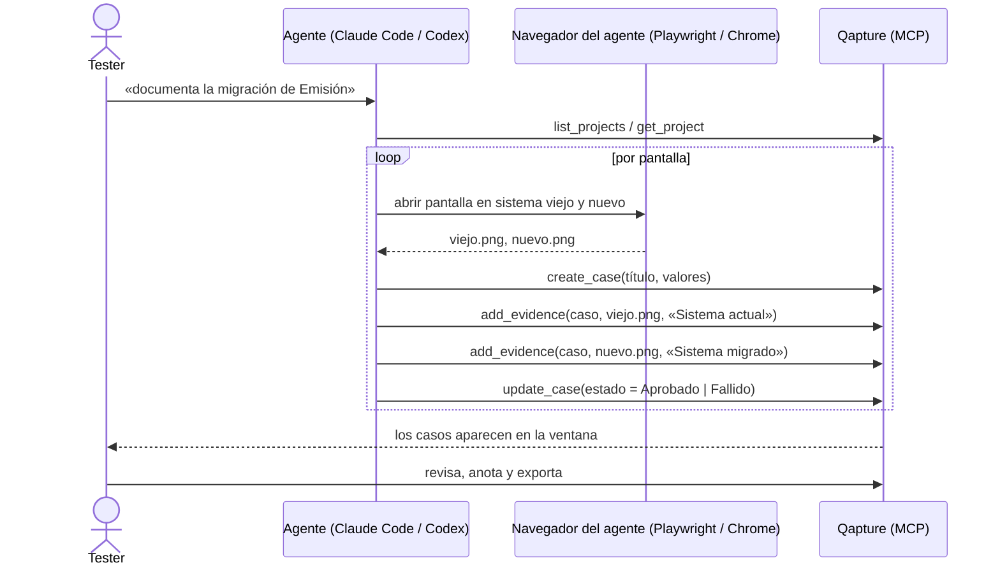
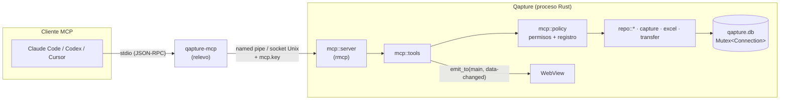

# Spec: servidor MCP para agentes (F9)

> Estado: **aprobado con ajustes** · Fecha: 2026-10-29 · Revisión externa: [respuesta de Manus](../manus/respuesta-spec.md), incorporada el mismo día
> Entregas: **F9a → v1.2**, **F9b → v1.2.x**. F8c y F8d se posponen y pasan a **v1.3** y **v1.4** **(decidido)**.

Marcas usadas en el documento:
- **(decidido)**: lo decidió el dueño del producto en la conversación de diseño.
- **(llamada del diseño)**: no se discutió; es una decisión razonable que se puede revisar sin rehacer el resto.

---

## 1. Intención

Hoy Qapture solo se maneja con la mano: la única puerta de entrada a los datos es el IPC de Tauri entre el proceso Rust y su propia ventana. Un agente de código (Claude Code, Codex, Cursor, Claude Desktop) no tiene cómo pedirle nada.

F9 le da a Qapture un **servidor MCP** (Model Context Protocol) **(decidido)** para que un agente pueda, con el permiso del tester:

1. Leer proyectos, campos, casos y evidencias.
2. Registrar casos y cambiar su estado y sus valores.
3. Adjuntar capturas que el agente tomó (por ejemplo, con Playwright o Claude in Chrome) o pedirle a Qapture que capture la pantalla o una ventana.
4. Exportar el Excel con carátula y el paquete `.qapture`.
5. (F9b) Preparar el reporte de un caso en GitHub para que el tester lo confirme.

MCP porque es el protocolo que ya hablan los agentes del equipo: una sola implementación sirve para Claude Code, Codex y los demás, y el agente descubre solo las herramientas y sus parámetros.

### Escenario real que tiene que funcionar

Migración de un módulo de GMX (por ejemplo, del front viejo al nuevo):

- El tester abre Claude Code o Codex en su máquina, con Qapture corriendo en la bandeja.
- Le pide: «documenta la migración del flujo de emisión de pólizas en el proyecto *GMX – Migración Emisión*: un caso por pantalla, captura del sistema viejo y del nuevo, y marca Aprobado o Fallido según coincidan».
- El agente navega ambos sistemas con su navegador, guarda cada captura en un PNG, y por MCP crea los casos, adjunta las capturas con su descripción y pone el estado.
- El tester ve los casos aparecer en Qapture en vivo, revisa, anota (flechas, desenfoque) lo que haga falta y exporta el Excel.



### Criterios de éxito

- Con Qapture instalado, el tester conecta Claude Code **y** Codex copiando la configuración desde **Ajustes › Agentes**, sin editar archivos a mano más allá de pegarla.
- El escenario de migración termina con 10+ casos y 20+ capturas creados por el agente, visibles en la ventana sin reiniciar, y un Excel exportado idéntico al que saldría si se hubieran cargado a mano.
- Con el permiso apagado (valor por defecto), ningún agente puede leer ni escribir nada.
- Nada que haga el agente publica fuera de la máquina sin un clic del tester.

## 2. Objetivos, no objetivos y anti-objetivos

**Objetivos (F9a):**
- Puente stdio `qapture-mcp` que instalan los instaladores de Windows y Linux.
- Servidor MCP dentro de la app, con herramientas de lectura, escritura de casos y evidencias, captura de pantalla y exportación.
- Ajustes › Agentes: interruptor, permisos por grupo, configuración para copiar y registro de actividad.
- Refresco en vivo de la ventana cuando un agente cambia datos.
- Un prompt MCP `documentar_migracion` que guía al agente en el flujo de arriba.

**Objetivos (F9b):**
- `request_github_report`: abre el diálogo «Reportar en GitHub» ya lleno y espera la decisión del tester.
- Anotaciones creadas por el agente (recuadros, flechas, números, desenfoque), editables después.

**No objetivos:**
- Transporte HTTP o acceso desde otra máquina.
- Borrar proyectos, casos o evidencias desde un agente.
- Que el agente lea archivos arbitrarios del disco a través de Qapture.
- Que Qapture navegue sistemas web: eso lo hace el navegador del agente.

**Anti-objetivos:**
- Un segundo proceso escribiendo en `qapture.db`. Todo pasa por la app abierta (§3, D2).

## 3. Decisiones

| # | Decisión | Por qué |
|---|---|---|
| D1 | **MCP sobre stdio**, versión del protocolo `2025-06-18` **(llamada del diseño)** | Es el transporte que soportan todos los clientes locales; no abre puertos. |
| D2 | **El MCP vive dentro de la app.** `qapture-mcp` es solo un relevo stdio ↔ canal local; no abre la base **(llamada del diseño)** | `AppState` guarda **una** conexión detrás de un `Mutex`; al arrancar, `sweep_orphans` borra imágenes sin fila (borraría las de otro proceso); el modo recuperación y las migraciones viven en la app; y la ventana tiene que refrescarse. Un solo escritor evita todo eso. |
| D3 | **Canal local:** named pipe en Windows (`\\.\pipe\qapture-mcp-<hash>`) y socket Unix en Linux (`$XDG_RUNTIME_DIR/qapture-mcp-<hash>.sock`). `<hash>` = 12 hex del SHA-256 de la carpeta de datos **(llamada del diseño)** | Sin puertos TCP ni firewall. El hash separa la instalación normal de la portable. |
| D4 | **Autenticación del canal:** ACL del pipe solo para el usuario actual (socket con `0600`) **y** un secreto en `<datos>/mcp.key` (32 bytes aleatorios, `0600`) que el puente manda en el primer mensaje **(llamada del diseño)** | Otro usuario de la máquina no puede conectarse; un proceso sin acceso a la carpeta de datos tampoco. |
| D5 | **Apagado por defecto.** Al encenderlo, **todos** los grupos (Lectura, Escritura, Captura de pantalla, Exportar y, en F9b, GitHub) siguen apagados; el tester marca cada uno. Cada grupo muestra nombre, descripción, herramientas que incluye y riesgo. Un botón **«Activar configuración recomendada»** marca Lectura y Escritura, solo si el tester lo pulsa **(decidido)** | «Lectura» no es inocua: casos y capturas pueden tener datos del cliente. El interruptor general nunca activa permisos por detrás. |
| D6 | **Si la app no está abierta**, el puente la lanza con `--hidden` (el mismo argumento del inicio con Windows) y reintenta 10 s **(llamada del diseño)** | El agente no tiene que pedirle al tester que abra la app. |
| D7 | **Protocolo escrito a mano**, sin `rmcp` **(llamada del diseño, cambiada en el plan)** | Usamos un subconjunto chico (`initialize`, `ping`, `tools/list`, `tools/call`, `prompts/list`, `prompts/get` y la notificación `tools/list_changed`) sobre JSON por líneas. Escrito a mano es una función pura `línea → respuestas` fácil de probar, sin atarse a la API de un SDK que todavía cambia ni sumar macros y tokio completo. |
| D8 | **Imágenes por ruta o base64.** `path` (absoluta) es lo preferido; `base64` para clientes sin disco compartido. PNG, JPEG o WebP, máximo 25 MB; se decodifican con `image` antes de guardar **(llamada del diseño)** | Playwright y Chrome ya guardan a archivo. Decodificar asegura que solo entren imágenes: la ruta nunca sirve para leer otra cosa y su contenido nunca vuelve al agente. |
| D9 | **Sin anotaciones en F9a:** la evidencia que crea el agente tiene `render` = original. Las anotaciones llegan en F9b **(llamada del diseño)** | Hoy el render lo hace el WebView (`add_evidence` recibe el PNG renderizado desde TS). Renderizar en Rust o en una ventana oculta es trabajo aparte. |
| D10 | **GitHub siempre con confirmación humana (F9b):** el agente no crea issues; abre el diálogo prellenado y la respuesta llega cuando el tester confirma o cancela **(llamada del diseño)** | Publicar es una acción externa. Además la plantilla del issue vive solo en TS (decisión de F8b), así que reutilizar el diálogo evita duplicarla en Rust. |
| D12 | **Saludo con versión del canal:** el primer mensaje del puente es `{ "qapture": "hello", "proto": 1, "key": "…", "bridge": "<versión>" }`; la app responde con su `proto` y versión. Si no coinciden, el puente no se cae: responde al agente con un servidor mínimo cuyo `qapture_status` explica el problema **(decidido, a partir de la revisión)** | Un puente viejo con una app nueva (o al revés, en la portable) debe dar un mensaje claro y no un «el servidor no arrancó». |
| D13 | **Las herramientas sin permiso no se listan.** `tools/list` solo devuelve las de los grupos activos (más `qapture_status`, siempre); al cambiar permisos se manda `notifications/tools/list_changed`. Si igual llaman a una oculta, error de permiso **(decidido, a partir de la revisión)** | Ofrecerlas y fallar después hace que el agente reintente en bucle. |
| D14 | **Confirmación por uso en Captura y Exportar:** diálogo nativo «Permitir / Rechazar» en cada llamada, con una casilla en Ajustes para dejar de preguntar (activa por defecto). Escritura no pide confirmación por operación: basta el permiso y el registro **(decidido, a partir de la revisión)** | Diez confirmaciones por migración matarían la automatización; capturar la pantalla o sacar archivos de la app sí merecen un clic. |
| D15 | **Reinicio de la app sin cortar al agente:** si el canal se cierra (actualización, reinicio), el puente reconecta (lanza la app si hace falta, 10 s), repite el saludo y el `initialize` guardado del cliente sin reenviarle la respuesta. Las llamadas en vuelo se responden con error `Qapture se reinició; vuelve a intentar.` **(llamada del diseño)** | El updater de F7 reinicia la app; el agente no debería tener que reconectar a mano. |
| D11 | **Todo lo que hace un agente queda registrado** (herramienta, cliente, proyecto, caso, resultado, fecha) y la ventana muestra un toast «Un agente creó EJ-014» agrupado cada 5 s **(llamada del diseño)** | El tester sabe qué cambió y quién lo cambió. |

## 4. Arquitectura



### 4.1 Rust

| Módulo | Responsabilidad |
|---|---|
| `src/bin/qapture-mcp.rs` | Segundo binario del mismo crate. Resuelve la carpeta de datos con `system::portable::resolve_data_dir` (como la app), arma el nombre del canal, lanza la app si hace falta (D6), manda `mcp.key` y copia bytes entre stdio y el canal. Sin lógica de negocio. |
| `src/mcp/channel.rs` | Escucha el pipe o socket (D3), valida el secreto (D4), una tarea por conexión; varias conexiones a la vez. |
| `src/mcp/server.rs` | `initialize` (nombre `qapture`, versión de la app, `instructions` cortas en español), `tools/list`, `tools/call`, `prompts/list`, `prompts/get`. |
| `src/mcp/tools.rs` | Una función por herramienta (§5). Valida la entrada, llama a `repo::*` con `state.db()` y devuelve el DTO en JSON. Misma barrera que los comandos: rutas solo vía `EvidenceFiles`. |
| `src/mcp/policy.rs` | Interruptor, permisos por grupo, modo recuperación (escritura rechazada), registro de actividad. |
| `src/mcp/events.rs` | `data-changed { projectId, caseId? }` a la ventana `main` y el toast agrupado (D11). |
| `src/repo/agent_activity.rs` | Tabla nueva (§6). |

El servidor arranca en `setup` después de `app.manage(state)`, en una tarea de tokio. Hoy `tokio` solo trae `time`; se agregan `rt-multi-thread`, `net` e `io-util` **(llamada del diseño)**.

### 4.2 TypeScript

- `ports/AgentSettings` y su adaptador (`mcp_get_settings`, `mcp_save_settings`, `mcp_activity`, `mcp_client_config`).
- **Ajustes › Agentes** (§7).
- Los slices de proyectos, casos y evidencias escuchan `data-changed` y recargan lo que cambió.
- F9b: `request_github_report` reutiliza el diálogo de F8b; el slice de GitHub escucha `mcp-report-request` y devuelve la decisión con `mcp_report_decision`.

### 4.3 Instaladores

- Tauri `bundle.externalBin` exige el sufijo del target (`qapture-mcp-x86_64-pc-windows-msvc.exe`); `scripts/` copia el binario compilado con ese nombre antes de `tauri build`. Queda instalado junto a `qapture.exe` como `qapture-mcp.exe`.
- ZIP portable: `qapture-mcp.exe` junto al exe; como resuelve la carpeta de datos igual que la app, apunta a la instancia portable.
- Linux: AppImage, `.deb` y `.rpm` llevan `qapture-mcp`. En AppImage la ruta para la configuración se muestra extraída a `~/.local/share/qapture/bin/` en el primer arranque (el AppImage no tiene ruta estable) **(llamada del diseño)**.

## 5. Herramientas

Nombres en inglés y `snake_case` (lo que esperan los agentes); descripciones, mensajes y resultados en español. Toda herramienta declara `inputSchema` con `additionalProperties: false` y anotaciones MCP (`readOnlyHint`, `destructiveHint: false`, `openWorldHint` solo en GitHub).

### 5.1 F9a

| Herramienta | Grupo | Entrada → salida |
|---|---|---|
| `qapture_status` | (siempre) | — → versión, modo recuperación, permisos activos, cuenta GitHub conectada (sin token) |
| `list_templates` | Lectura | — → plantillas |
| `list_projects` | Lectura | — → `ProjectSummaryDto[]` |
| `get_project` | Lectura | `projectId` → proyecto, campos (tipo, opciones, obligatorio) y estados válidos |
| `list_cases` | Lectura | `projectId`, `status?`, `text?`, `limit?` (100), `cursor?` → `CaseDto[]` paginado |
| `get_case` | Lectura | `caseId` o `projectId + code` → caso con sus evidencias (metadatos, sin imagen) |
| `get_evidence_image` | Lectura | `evidenceId`, `variant` (`render` \| `original`) → contenido MCP `image` (PNG reducido a 1568 px de lado mayor) |
| `create_project` | Escritura | `templateId` (de una plantilla existente; no se crean ni modifican plantillas), `meta` validado igual que en la UI → id, nombre, plantilla y fecha de creación |
| `create_case` | Escritura | `projectId`, `title`, `status?` (por defecto `No ejecutado`), `values?` (por id, `key` o etiqueta del campo) → caso |
| `update_case` | Escritura | `caseId`, `title?`, `status?`, `values?` (se **mezclan** con los existentes) → caso |
| `add_evidence` | Escritura | `caseId`, `path` **o** `base64`, `description?`, `position?` → evidencia |
| `update_evidence_description` | Escritura | `evidenceId`, `description` → evidencia |
| `capture_screen` | Captura | `caseId`, `target` (`{ monitor: n }` \| `{ window: «título contiene» }` \| `primary`), `description?` → evidencia. Sin overlay: captura directa con `xcap` |
| `list_windows` | Captura | — → títulos de ventanas visibles (para elegir `target.window`) |
| `export_excel` | Exportar | `projectId`, `folder?` (por defecto la de Ajustes) → ruta del `.xlsx` |
| `export_package` | Exportar | `projectId`, `folder?` → ruta del `.qapture` |

`update_case` mezcla valores porque `CaseInput` reemplaza todo: la herramienta lee el caso, aplica los cambios y llama a `repo::cases::update`. `values` acepta la etiqueta visible («Módulo») además del id para que el agente no tenga que traducir; si una etiqueta es ambigua o no existe, error con la lista de campos válidos.

### 5.2 F9b

| Herramienta | Grupo | Entrada → salida |
|---|---|---|
| `request_github_report` | GitHub | `caseId`, `repo?`, `evidenceIds?`, `title?` → abre el diálogo de F8b prellenado y muestra la ventana; espera hasta 10 min → `{ estado: creado \| comentado \| cancelado \| sin_respuesta, url? }` |
| `annotate_evidence` | Escritura | `evidenceId`, `shapes[]` (`rect`, `arrow`, `number`, `text`, `highlight`, `blur`) en coordenadas de la imagen original → evidencia con render nuevo y anotaciones editables en el editor |

### 5.3 Prompt `documentar_migracion`

Argumentos: `proyecto`, `modulo`, `url_actual`, `url_nueva`. Devuelve instrucciones para el agente: confirmar el proyecto con `get_project`, un caso por pantalla con el código de la matriz, dos capturas por caso («Sistema actual» y «Sistema migrado»), estado Aprobado si coinciden y Fallido con la diferencia en «Resultado obtenido», no capturar datos personales reales sin avisar, y terminar con `export_excel` solo si el tester lo pide.

## 6. Modelo de datos (migración `0006_agents.sql`)

```sql
CREATE TABLE agent_activity (
  id          TEXT PRIMARY KEY,
  at          TEXT NOT NULL,          -- ISO 8601
  client      TEXT NOT NULL,          -- clientInfo.name del initialize, p. ej. «claude-code»
  tool        TEXT NOT NULL,
  project_id  TEXT,
  case_id     TEXT,
  ok          INTEGER NOT NULL,
  detail      TEXT NOT NULL           -- resumen sin imágenes ni secretos
);
CREATE INDEX agent_activity_at ON agent_activity(at);
```

- Se guardan los últimos 2 000 registros; los más viejos se borran al insertar **(llamada del diseño)**.
- Los ajustes (`enabled`, permisos por grupo) viven en la tabla `setting` de la migración 0004, como el resto de `Settings`.
- `agent_activity` **no** viaja en paquetes `.qapture` ni en el Excel; sí en los respaldos (es parte de la base).

## 7. Ajustes › Agentes

- Interruptor **«Permitir que agentes de IA usen Qapture (MCP)»**, apagado.
- Casillas por grupo, todas apagadas (D5), cada una con descripción, herramientas y riesgo:
  - **Lectura:** consultar proyectos, casos, campos y evidencias. Puede exponer datos del cliente al agente.
  - **Escritura:** crear proyectos (desde plantillas existentes) y casos, cambiar estados y valores, adjuntar evidencias. Nunca borra.
  - **Captura de pantalla:** capturar un monitor o una ventana visible. Pide confirmación en cada uso (D14).
  - **Exportar:** crear `.xlsx` y `.qapture` en la carpeta elegida. Pide confirmación en cada uso (D14).
  - **GitHub (F9b):** preparar un reporte que el tester confirma.
- Botón **«Activar configuración recomendada»** (Lectura y Escritura).
- **Conectar un agente**: pestañas Claude Code, Codex, Cursor, Claude Desktop con el bloque listo y botón «Copiar». Por ejemplo:
  - Claude Code: `claude mcp add qapture -- "C:\Program Files\Qapture\qapture-mcp.exe"`
  - Codex (`~/.codex/config.toml`):
    ```toml
    [mcp_servers.qapture]
    command = 'C:\Program Files\Qapture\qapture-mcp.exe'
    ```
  - Cursor y Claude Desktop: bloque `mcpServers` en JSON.
  La ruta es la real de la instalación (o la portable).
- **Actividad**: tabla de los últimos registros con filtro por cliente y botón «Ir al caso».
- **Regenerar clave**: crea un `mcp.key` nuevo y corta las conexiones abiertas.

## 8. Errores, seguridad y privacidad

- Errores de herramienta como resultado MCP con `isError: true` y texto fijo; los de protocolo como errores JSON-RPC. `AppError` se traduce igual que en los comandos.
- **Mensajes fijos:**
  - `Los agentes están desactivados. Actívalos en Ajustes › Agentes.`
  - `El permiso «<grupo>» está desactivado en Ajustes › Agentes.`
  - `Qapture está en modo recuperación: solo se permite leer.`
  - `No se encontró Qapture y no se pudo abrir. Ábrelo y vuelve a intentar.` (puente)
  - `La clave del agente no es válida. Copia de nuevo la configuración desde Ajustes › Agentes.` (puente)
  - `El archivo no es una imagen PNG, JPEG o WebP.` · `La imagen supera 25 MB.` · `La ruta debe ser absoluta.`
  - `qapture-mcp (<v>) no es compatible con Qapture (<v>). Reinstala Qapture para actualizar los dos.` (D12)
  - `El tester rechazó la <captura | exportación>.` (D14) · `Qapture se reinició; vuelve a intentar.` (D15)
  - `El campo «<x>» no existe en el proyecto. Campos: <lista>.` · `«<x>» no es un estado válido. Estados: <lista>.`
  - `No hay ninguna ventana cuyo título contenga «<x>».`
- **Registro de actividad:** guarda cliente, herramienta, proyecto, caso, resultado y un resumen; **nunca** rutas de archivos, base64, contenido de imágenes ni la clave.
- **Seguridad:** sin puertos de red; canal solo del usuario + secreto (D4); el token de GitHub nunca se expone (ni en `qapture_status`); `path` se abre en solo lectura, se decodifica como imagen y nunca se devuelve su contenido; sin herramientas de borrado; `get_evidence_image` solo sirve evidencias de la base, nunca rutas libres.
- **Privacidad:** `capture_screen` siempre muestra una notificación del sistema «Un agente capturó la pantalla» y queda en la actividad. El texto de `initialize` recuerda al agente usar `annotate_evidence` (F9b) o pedir revisión antes de exportar si capturó datos sensibles.
- **Inyección de instrucciones:** los valores de los casos son datos del usuario; las descripciones de las herramientas lo dicen explícitamente para que el agente no los trate como órdenes.

## 9. Pruebas

- **Rust (unitarias):** cada herramienta contra una base en memoria y `EvidenceFiles` temporal: mezcla de valores, etiquetas ambiguas, estados inválidos, imágenes falsas (texto con extensión `.png`), tamaño máximo, modo recuperación, permisos apagados, registro de actividad y poda a 2 000.
- **Protocolo:** `initialize` → `tools/list` comparado con un snapshot (nombres, esquemas, anotaciones) y `tools/call` de punta a punta sobre un pipe de prueba.
- **Puente:** clave inválida, app cerrada (lanza y reintenta), dos clientes a la vez.
- **TS:** el slice recarga con `data-changed`; Ajustes › Agentes copia la configuración correcta según instalada o portable.
- **Manual (checklist):** MCP Inspector; Claude Code y Codex en Windows con el escenario de migración contra un proyecto ficticio; versión portable; actualización con un agente conectado (D15).
- **Linux (no bloquea F9a):** construir el AppImage no basta. Antes de anunciar soporte Linux del MCP se hace una prueba de humo en Ubuntu 22.04 o 24.04 con escritorio (máquina real o virtual): arranque, `qapture-mcp` ejecutable, el puente lanza la app, socket y `mcp.key` con `0600`, `initialize` / `tools/list` / `tools/call`, persistencia, captura y exportación. Se anotan distribución, versión, escritorio y resultado.

## 10. Documentación

- `docs/usuario/agentes.md`: qué es, cómo activarlo, cómo conectar cada cliente, qué puede y qué no puede hacer el agente, y el ejemplo de la migración.
- `docs/adr/0006-servidor-mcp.md`: D2 y D3 (por qué un relevo y no acceso directo a SQLite ni HTTP).
- `docs/arquitectura.md`: diagrama de §4.
- README: sección «Usar Qapture con agentes».

## 11. Fases y orden

| Fase | Versión | Contenido | Puerta de salida |
|---|---|---|---|
| **F9a** | v1.2 | Puente, canal, servidor, herramientas §5.1, prompt, migración 0006, Ajustes › Agentes, `data-changed`, instaladores, guías y ADR | **Obligatoria:** escenario de §1 con Claude Code **y** Codex en Windows. **Adicional:** prueba de humo Linux (§9) antes de declarar Linux soportado; no bloquea el cierre **(decidido)** |
| **F9b** | v1.2.x | `request_github_report`, `annotate_evidence` | Un agente prepara un issue con 2 capturas anotadas y el tester lo confirma en el diálogo |
| F8c | v1.3 | Spec de GitHub §9 | Igual que antes |
| F8d | v1.4 | Spec de GitHub §10 | Igual que antes |

Cada fase tiene su contrato en `docs/superpowers/contracts/` y su plan, que se escribe al iniciarla.

## 12. Qué queda a criterio de quien implemente

- Nombres internos de módulos y tipos; si `rmcp` no encaja (D7), escribir el protocolo a mano.
- Cómo se agrupan los toasts (D11), siempre que no haya más de uno cada 5 s.
- El tamaño de página de `list_cases`.

## 13. Preguntas resueltas (2026-10-29)

1. **Permisos:** todo apagado al encender; el tester marca cada grupo; botón explícito de configuración recomendada (D5).
2. **Proyectos:** el agente puede crearlos con `create_project`, dentro de Escritura, solo desde plantillas existentes y sin borrar nada (§5.1).
3. **Linux:** Windows cierra F9a; Linux necesita su prueba de humo real antes de declararse soportado (§9, §11).
