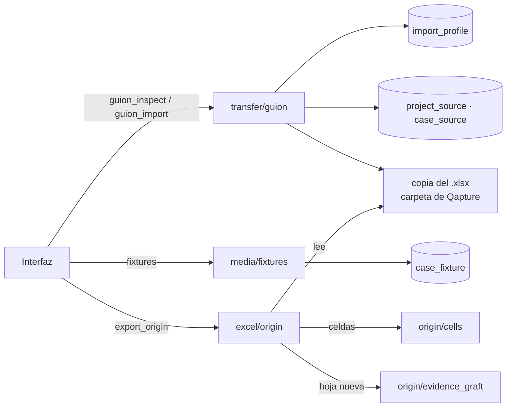

# Spec: del guion de pruebas a las evidencias (G1, G2, G4)

> Estado: **aprobado** · Fecha: 2026-11-10
> Entrega: **G1 + G2 + G4 → v1.3.0** en un solo release. F8c y F8d pasan a **v1.4** y **v1.5** **(decidido)**.
> Contrato: [G-guion-a-evidencias](../contracts/G-guion-a-evidencias.md).
> Origen: [propuesta `guion-a-evidencias`](../../propuestas/guion-a-evidencias/README.md) (documentos 01 a 05) y las respuestas del cliente del 2026-11-10 (documento 05, bloque A).
> Caso de referencia: una orden de trabajo real de un cliente (su nombre, su sistema y sus archivos se omiten a propósito). Su guion es un Excel con carátula, encabezados en la fila 15 y 36 casos.

Marcas usadas en el documento:
- **(decidido)**: lo decidió el cliente o el dueño del producto.
- **(llamada del diseño)**: decisión razonable que se puede revisar sin rehacer el resto.
- **(por confirmar)**: hace falta que el dueño del producto la apruebe antes de escribir el plan.

---

## 1. Intención

Un cliente entrega su guion de pruebas en Excel y espera recibir **el mismo archivo ejecutado**, con sus evidencias. Hoy en Qapture eso exige capturar la matriz a mano y llenar el formato del cliente a mano.

Esta fase hace que Qapture:

1. **Importe el guion** del cliente como proyecto, con sus columnas reales, sin agente y sin IA (G1).
2. **Guarde los archivos de prueba de cada caso** junto al caso, para que el tester los tenga a mano al ejecutar (G2, solo la parte de datos de prueba).
3. **Devuelva el archivo del cliente ejecutado**: los valores escritos en sus celdas y una hoja «Evidencias» añadida al mismo libro (G4, opción a).

La ejecución es **manual asistida**: el tester ejecuta y captura con `Ctrl+Alt+S`, que ya existe **(decidido: respuesta A5 del cliente)**.

### Escenario que tiene que funcionar

1. El tester abre «Datos › Importar guion de pruebas…», elige el guion del cliente (`guion_cliente.xlsx`) y, en menos de un minuto, tiene un proyecto con 36 casos (CP01 a CP36) y las 13 columnas del guion.
2. Adjunta a cada caso su archivo de prueba (por ejemplo, `F13_valor_distinto.xlsx` a los seis casos que lo usan).
3. Ejecuta en el sistema bajo prueba, captura con `Ctrl+Alt+S`, pone estado, fecha, tester y condiciones.
4. Usa «Exportar › Formato de origen» y obtiene `guion_cliente_ejecutado.xlsx`: abre en Excel sin aviso de reparación, conserva logos, celdas combinadas, validaciones, autofiltro y área de impresión, trae llenas las columnas I, K, L y M de las 36 filas y tiene una hoja «Evidencias» nueva.

### Criterios de éxito

- El guion de referencia se importa sin editar el archivo.
- El archivo exportado pasa la prueba de ida y vuelta: todo lo que no es una celda escrita por Qapture queda **byte a byte igual** dentro del ZIP, salvo `workbook.xml`, sus relaciones y `[Content_Types].xml`, que solo **agregan** la hoja nueva.
- Un segundo guion del mismo cliente se importa con el perfil guardado, sin volver a mapear.

## 2. Objetivos, no objetivos y anti-objetivos

**Objetivos:** los tres de la sección 1.

**No objetivos (esta fase):**
- Plan de ejecución por caso, corridas y estado «Propuesto» (G3).
- Herramientas MCP nuevas (`import_guion`, `list_case_fixtures`, documentos fuente para agentes). El cliente no usa agente **(decidido: A5)**.
- Documentos fuente del proyecto (ODT, análisis): no hay quién los consuma sin agente **(llamada del diseño)**.
- Exportar evidencias como anexo Word, PDF o carpeta **(decidido: A1)**.
- Importar `.xls`, Word o PDF como guion. Solo `.xlsx` **(llamada del diseño: G4 tiene que escribir sobre el mismo archivo)**.
- Fusionar un segundo import sobre un proyecto existente: cada import crea un proyecto nuevo.
- Puente con Tija (G5).

**Anti-objetivos:**
- Nada específico de un cliente en el código: fila 15, nombres de columna y vocabulario de estado viven en un **perfil de importación** guardado como dato.
- No regenerar el formato del cliente con `rust_xlsxwriter`: se devuelve **su** archivo.
- No corregir el archivo del cliente (validaciones de las filas 16 a 35, «Crìtico»): solo se escriben valores **(decidido: C6, decisión por defecto)**.

## 3. Decisiones

| # | Tema | Decisión | Marca |
|---|---|---|---|
| D1 | Columnas del guion | El import crea los campos del proyecto (`project_field`) a partir del mapeo. **No** se agrega una plantilla integrada «Guion de pruebas». | llamada del diseño |
| D2 | Perfil de importación | Tabla `import_profile` con el perfil como JSON versionado (sección 5). Se guarda con nombre («Cliente A · guion v3») y se ofrece al importar el siguiente guion. | llamada del diseño |
| D3 | Origen del proyecto | Al importar, Qapture **guarda una copia del `.xlsx`** en su carpeta de archivos y anota archivo, hoja, fila de encabezados y fila de cada caso. G4 escribe sobre esa copia; el original del tester no se toca. | llamada del diseño |
| D4 | Estados al importar | Aceptado o Aprobado → Aprobado; Rechazado → Fallido; Condicionado → Aprobado con la marca «Condicionado»; vacío → No ejecutado. La comparación ignora mayúsculas, acentos y espacios. | decidido (propuesta 03, P3) |
| D5 | «Condicionado» en Qapture | Campo booleano del proyecto `condicionado` («Condicionado»), creado por el perfil cuando el vocabulario del cliente lo tiene. No se agrega un estado nuevo: no cambia las métricas. | decidido (2026-11-10) |
| D6 | Estados al exportar | Aprobado → «Aceptado» (o «Condicionado» si la marca está activa); Fallido → «Rechazado»; No ejecutado, En ejecución y Por documentar → celda vacía; Bloqueado → celda vacía y «Bloqueado: <motivo>» al inicio de Condiciones. El valor exacto de cada estado sale del perfil. | decidido (C1 y C2 por defecto) |
| D7 | Fecha y tester por caso | Columna «Fecha de Prueba»: el valor del campo; si está vacío, la fecha de la última evidencia del caso; si no hay, vacía. «Nombre del tester»: el valor del campo; si está vacío, el tester de Ajustes. | llamada del diseño |
| D8 | Carátula | El perfil indica las celdas de fecha de la prueba, responsable y observaciones. El import las **detecta por su etiqueta** (la celda de valor es la primera no vacía a la derecha de «Fecha de la prueba», «Responsable», «Observaciones») y el tester las confirma. Al exportar se escriben: fecha de la última ejecución, tester de Ajustes y un texto editable en el diálogo. | llamada del diseño |
| D9 | Cómo se escribe el archivo | Edición del XML dentro del ZIP: solo se cambian las celdas destino de la hoja del guion. El texto se escribe como cadena en línea (`t="inlineStr"`) para no tocar `sharedStrings.xml`; las fechas, como número de serie con el estilo que ya tenía la celda. | decidido (propuesta 03, G4) |
| D10 | Hoja «Evidencias» | Se genera en un libro temporal con `rust_xlsxwriter`, reutilizando `excel::evidence_sheet` e `excel::images`, y se **trasplanta** al libro del cliente (hoja, dibujo, relaciones e imágenes). Si el trasplante resulta inviable en el pico técnico (tarea 0 del plan), se para y se vuelve a decidir con el dueño del producto. | llamada del diseño |
| D11 | Nombre del archivo exportado | El nombre del guion con el sufijo `_ejecutado` **(decidido: C5 por defecto)**. Si existe, el diálogo de guardar pregunta. | decidido |
| D12 | Archivos de prueba | Tabla `case_fixture`; archivos guardados en la carpeta de Qapture, de solo lectura. Extensiones: `.xlsx`, `.xls`, `.csv`, `.txt`, `.pdf`, `.json`, `.xml`, `.zip`; hasta 25 MB cada uno. Nunca se abren ni se ejecutan desde Qapture: «Mostrar en carpeta» y «Copiar ruta». | llamada del diseño |
| D13 | Paquetes y respaldos | Los archivos de prueba y la copia del guion viajan en el paquete `.qapture` (formato 2, que sigue leyendo el formato 1) y en los respaldos. | llamada del diseño |
| D14 | Versionado | G1, G2 y G4 salen juntas en **v1.3.0**: el cliente necesita las tres para recibir su entregable. Un contrato para la fase y un plan por subfase. F8c y F8d pasan a v1.4 y v1.5. | decidido (2026-11-10) |

## 4. Arquitectura



### 4.1 Rust

| Módulo | Responsabilidad |
|---|---|
| `transfer/guion/read.rs` | Leer el `.xlsx` con `calamine` (pasa de dependencia de pruebas a producción): hojas visibles, celdas de texto, fila de encabezados sugerida |
| `transfer/guion/profile.rs` | Perfil: tipos, validación, aplicación del mapeo a filas; equivalencia de estados (D4) |
| `transfer/guion/import.rs` | Vista previa con avisos y alta de proyecto, campos, casos, origen y copia del archivo, todo o nada |
| `media/fixtures.rs` | Guardar, listar y quitar archivos de prueba (D12) |
| `excel/origin/mod.rs` | Orquesta la exportación al formato de origen |
| `excel/origin/cells.rs` | Escribir valores en celdas existentes del XML de una hoja (D9) |
| `excel/origin/evidence_graft.rs` | Trasplantar la hoja «Evidencias» al libro del cliente (D10) |
| `commands/guion.rs`, `commands/fixtures.rs` | Comandos Tauri y sus permisos en la capability |

### 4.2 TypeScript

Puertos `GuionImporter` y `FixtureStore`; casos de uso en `application/use-cases.ts`; asistente `ui/screens/ImportGuionDialog.tsx` (tres pasos); sección «Archivos de prueba» en `CaseDetail`; opción «Formato de origen» en `ExportDialog`, visible solo en proyectos importados. Implementaciones en memoria y Tauri, como el resto de los puertos.

## 5. Modelo de datos (migración `0007_guion.sql`)

| Tabla | Columnas | Notas |
|---|---|---|
| `import_profile` | `id`, `name` (único, sin distinguir mayúsculas), `definition` (JSON), `created_at`, `updated_at` | |
| `project_source` | `project_id` (PK, FK con cascada), `file_name`, `stored_path`, `sha256`, `sheet`, `header_row`, `profile_id` (nulo si se borró el perfil), `imported_at` | Un proyecto tiene como mucho un origen |
| `case_source` | `case_id` (PK, FK con cascada), `row` | Fila del caso en la hoja de origen (1-based) |
| `case_fixture` | `id`, `case_id` (FK con cascada), `file_name`, `stored_path`, `size`, `sha256`, `note`, `position`, `added_at` | |

Definición del perfil (JSON, `version: 1`):

```json
{
  "version": 1,
  "sheet": "Guión de Pruebas",
  "headerRow": 15,
  "columns": [
    {"column": "C", "header": "ID", "target": {"kind": "code"}},
    {"column": "F", "header": "Escenario de Prueba", "target": {"kind": "title"}},
    {"column": "K", "header": "Status", "target": {"kind": "status"}},
    {"column": "E", "header": "RN", "target": {"kind": "field", "key": "rn", "label": "RN", "type": "text"}},
    {"column": "H", "header": "Criticidad", "target": {"kind": "field", "key": "criticidad", "label": "Criticidad", "type": "list", "options": ["Crítico", "Importante"]}},
    {"column": "I", "header": "Fecha de Prueba", "target": {"kind": "field", "key": "fecha_prueba", "label": "Fecha de Prueba", "type": "date", "role": "executionDate"}},
    {"column": "L", "header": "Nombre del tester", "target": {"kind": "field", "key": "tester", "label": "Nombre del tester", "type": "text", "role": "tester"}},
    {"column": "M", "header": "Condiciones", "target": {"kind": "field", "key": "condiciones", "label": "Condiciones", "type": "longtext", "role": "conditions"}}
  ],
  "statusMap": {
    "import": {"aceptado": "Aprobado", "aprobado": "Aprobado", "rechazado": "Fallido", "condicionado": "Aprobado+condicionado", "": "No ejecutado"},
    "export": {"Aprobado": "Aceptado", "Aprobado+condicionado": "Condicionado", "Fallido": "Rechazado"}
  },
  "cover": {"executionDate": "D5", "responsible": "D6", "observations": "D10"}
}
```

`role` dice a G4 qué columna recibe qué dato. Las celdas de `cover` del ejemplo son ilustrativas: se detectan en el import (D8).

## 6. Interfaz

- **Importar guion** (menú Datos): 1) archivo y hoja (solo hojas visibles; perfil sugerido si coincide nombre de hoja y encabezados); 2) fila de encabezados (sugerida: primera fila con al menos cuatro celdas de texto seguidas y datos debajo; editable) y mapeo por columna: código, título, estado, campo existente, campo nuevo con tipo sugerido o «No importar»; carátula detectada; 3) vista previa con los casos y los avisos (filas vacías, códigos repetidos, valores fuera de lista, estados desconocidos). «Importar» crea todo o nada. Casilla «Guardar como perfil» con nombre.
- **Archivos de prueba** (detalle del caso): lista con nombre, tamaño y nota; «Agregar…» (diálogo de archivo o arrastrar), «Mostrar en carpeta», «Copiar ruta», «Quitar» con confirmación.
- **Exportar › Formato de origen**: muestra el archivo de origen, la cantidad de casos que se escriben y de evidencias, el texto de observaciones de la carátula y la casilla «Agregar hoja Evidencias» (marcada). Mantiene el aviso de datos personales en capturas que ya existe.

## 7. Errores y casos borde

| Situación | Comportamiento |
|---|---|
| Archivo no `.xlsx`, protegido con contraseña o dañado | Mensaje claro; no se crea nada |
| Hoja sin fila de encabezados reconocible | El paso 2 pide elegir la fila a mano |
| Columna de código sin mapear, o códigos vacíos o repetidos | La vista previa lo marca como error; «Importar» queda deshabilitado |
| Valor de estado fuera del perfil | Aviso; el caso entra como «No ejecutado» y el valor original queda en Condiciones |
| Valor de lista fuera de las opciones («Crìtico») | Se compara sin acentos; si coincide, se normaliza a la opción; si no, se agrega la opción y se avisa |
| Proyecto con origen cuya copia del `.xlsx` falta o cambió de `sha256` | «Formato de origen» deshabilitado con el motivo |
| El tester cambió el código de un caso o borró casos | Se escribe por fila de origen (`case_source.row`), no por código; los casos nuevos sin fila se listan como «no se escriben» antes de exportar |
| Hoja con fórmulas o celdas compartidas en las columnas destino | Se sobrescribe solo el valor de esa celda y se quita su fórmula; se avisa en el diálogo |
| Libro que ya tiene una hoja «Evidencias» | La nueva se llama «Evidencias (Qapture)» |

## 8. Pruebas

- Fixture sintético que imita el guion de referencia (carátula en filas 1 a 12, encabezados en la 15, 36 casos, celdas combinadas, validación de datos en filas 16 a 35 con «Crìtico», hoja oculta, autofiltro, área de impresión, una imagen de logo). Se genera en el test; **el archivo real del cliente nunca entra al repo**.
- Ida y vuelta: importar el fixture → poner estados y evidencias → exportar → comparar el ZIP parte por parte con el original (criterio de éxito 2) y leer los valores con `calamine`.
- Unitarias de perfil (equivalencia de estados, detección de encabezados, carátula), de escritura de celdas (texto, fecha, celda inexistente, celda con fórmula) y de archivos de prueba (extensión, tamaño, duplicados).
- Contrato TS ↔ Rust de los comandos nuevos (ADR 0004).
- Prueba manual: abrir el exportado en Excel de escritorio y en LibreOffice sin aviso de reparación.

## 9. Fases

| Subfase | Entrega | Criterio de salida |
|---|---|---|
| G1 | Importar guion + perfil + origen guardado | El guion de referencia produce 36 casos con 13 columnas en menos de un minuto, sin editar el archivo |
| G2 | Archivos de prueba por caso, en paquetes y respaldos | Los 15 archivos F01 a F15 quedan asociados a sus casos y sobreviven a exportar e importar un paquete |
| G4 | Exportar al formato de origen con hoja «Evidencias» | Criterios de éxito 1 y 2 sobre el fixture y sobre el guion real del cliente (solo en local) |

Las tres salen en **v1.3.0** (D14). G4 empieza con un **pico técnico** (trasplante de la hoja con imágenes sobre el fixture) que va primero, porque es el mayor riesgo de la fase: si falla, se replantea G4 antes de invertir en G1 y G2.

## 10. Qué queda a criterio de quien implemente

Nombres internos, estructura de los componentes React, el texto exacto de los avisos (en español, sin jerga técnica) y el algoritmo de comparación sin acentos.

## 11. Preguntas resueltas (2026-11-10)

1. **D5:** «Condicionado» es una casilla del proyecto, no un estado nuevo.
2. **D14:** un solo release v1.3.0 con G1, G2 y G4; un contrato para la fase y un plan por subfase.
3. **Privacidad del repo:** la propuesta con datos del cliente (`docs/propuestas/guion-a-evidencias/`) queda fuera del repo por `.gitignore`. Este spec sí se versiona: describe el formato de un guion, no datos del cliente. El archivo real del cliente nunca entra al repo (sección 8).
